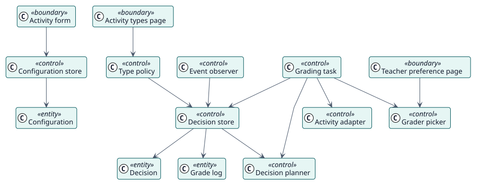

# Analysis

## Analysis classes

Stereotypes: `<<boundary>>` interface, `<<control>>` coordination, `<<entity>>` domain information.

| Class | Stereotype | Responsibility |
| --- | --- | --- |
| Activity form, Activity types page, Teacher preference page | boundary | The screens through which teachers and administrators work. |
| Configuration store, Type policy | control | Save the configuration of an activity and the enabled types. |
| Decision planner | control | Decides, from live data, whether a student did the activity and when the grade is due. |
| Decision store | control | Creates, moves, settles and cancels decisions and their tasks. |
| Event observer | control | Makes Autograder reconsider a student when the course changes. |
| Grading task | control | Checks again and gives the grade at the time it is due. |
| Grader picker | control | Chooses the teacher in whose name a grade is recorded. |
| Activity adapter | control | Reads submissions and dates, and writes the grade through each kind of activity. |
| Configuration, Decision, Grade log | entity | The stored information. |

## Use-case realizations

| ID | Use case | Collaboration |
| --- | --- | --- |
| UC-001 | [Configure Autograder in an activity](./use-cases/configureAutograder/README.md) | [collaboration](./use-cases/configureAutograder/collaboration.svg) |
| UC-002 | [Choose the activity types](./use-cases/chooseActivityTypes/README.md) | [collaboration](./use-cases/chooseActivityTypes/collaboration.svg) |
| UC-003 | [Grade a student](./use-cases/gradeStudent/README.md) | [collaboration](./use-cases/gradeStudent/collaboration.svg) |
| UC-004 | [Reconsider a decision when something changes](./use-cases/reconsiderDecision/README.md) | [collaboration](./use-cases/reconsiderDecision/collaboration.svg) |
| UC-005 | [Choose the result of a rubric or marking guide](./use-cases/chooseAdvancedGrade/README.md) | [collaboration](./use-cases/chooseAdvancedGrade/collaboration.svg) |
| UC-006 | [Opt out of having grades recorded in my name](./use-cases/optOutOfGrading/README.md) | [collaboration](./use-cases/optOutOfGrading/collaboration.svg) |
| UC-007 | [Set the policy of the site](./use-cases/setSitePolicy/README.md) | [collaboration](./use-cases/setSitePolicy/collaboration.svg) |
| UC-008 | [Tell the teachers which students could not be graded](./use-cases/notifyFailures/README.md) | [collaboration](./use-cases/notifyFailures/collaboration.svg) |
| UC-009 | [Queue again the grades that lost their task](./use-cases/requeueLostGrades/README.md) | [collaboration](./use-cases/requeueLostGrades/collaboration.svg) |
| UC-010 | [Delete the old history](./use-cases/purgeHistory/README.md) | [collaboration](./use-cases/purgeHistory/collaboration.svg) |
| UC-011 | [Carry the configuration in a course backup](./use-cases/carryConfigurationInBackup/README.md) | [collaboration](./use-cases/carryConfigurationInBackup/collaboration.svg) |
| UC-012 | [Export or erase personal data](./use-cases/managePersonalData/README.md) | [collaboration](./use-cases/managePersonalData/collaboration.svg) |
