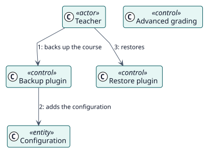

# UC-011 Carry the configuration in a course backup — analysis realization

| Overview | Requirements | Analysis | Design | Implementation | Tests |
| --- | --- | --- | --- | --- | --- |
| [Use cases](../../../requirements/use-case-overview.svg) | [Requirements](../../../requirements/use-cases/carryConfigurationInBackup/README.md) | **Analysis** | [Design](../../../design/use-cases/carryConfigurationInBackup/README.md) | [Implementation](../../../implementation/use-cases/carryConfigurationInBackup/README.md) | [Tests](../../../implementation/use-cases/carryConfigurationInBackup/README.md#tests) |

Requirements: [README](../../../requirements/use-cases/carryConfigurationInBackup/README.md)

## Participating classes

| Class | Stereotype | Responsibility |
| --- | --- | --- |
| Backup plugin | control | Adds the configuration of an activity to the backup. |
| Restore plugin | control | Writes the configuration against the restored activity and plans the students. |
| Advanced grading | control | Carries the choice of a rubric or guide to the restored criteria. |
| Configuration | entity | What travels. |

## Collaboration

## Notes

An activity that comes back enabled without anything to grade with would fail once for each student, at the moment each of them came due, with nothing on screen to say why.
