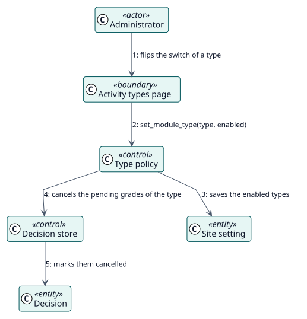

# UC-002 Choose the activity types — analysis realization

| Overview | Requirements | Analysis | Design | Implementation | Tests |
| --- | --- | --- | --- | --- | --- |
| [Use cases](../../../requirements/use-case-overview.svg) | [Requirements](../../../requirements/use-cases/chooseActivityTypes/README.md) | **Analysis** | [Design](../../../design/use-cases/chooseActivityTypes/README.md) | [Implementation](../../../implementation/use-cases/chooseActivityTypes/README.md) | [Tests](../../../implementation/use-cases/chooseActivityTypes/README.md#tests) |

Requirements: [README](../../../requirements/use-cases/chooseActivityTypes/README.md)

## Participating classes

| Class | Stereotype | Responsibility |
| --- | --- | --- |
| Activity types page | boundary | One row and one switch for each type. |
| Type policy | control | Saves the enabled types. |
| Decision store | control | Cancels the pending decisions of the type. |
| Site setting | entity | The list of enabled types. |
| Decision | entity | The record that is cancelled. |

## Collaboration

## Notes

Each activity keeps its own configuration, so turning the type on again resumes it, except where a grade was already recorded.
