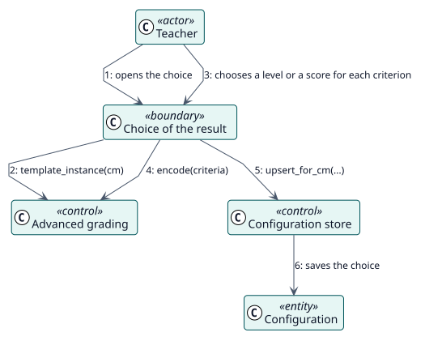

# UC-005 Choose the result of a rubric or marking guide — analysis realization

| Overview | Requirements | Analysis | Design | Implementation | Tests |
| --- | --- | --- | --- | --- | --- |
| [Use cases](../../../requirements/use-case-overview.svg) | [Requirements](../../../requirements/use-cases/chooseAdvancedGrade/README.md) | **Analysis** | [Design](../../../design/use-cases/chooseAdvancedGrade/README.md) | [Implementation](../../../implementation/use-cases/chooseAdvancedGrade/README.md) | [Tests](../../../implementation/use-cases/chooseAdvancedGrade/README.md#tests) |

Requirements: [README](../../../requirements/use-cases/chooseAdvancedGrade/README.md)

## Participating classes

| Class | Stereotype | Responsibility |
| --- | --- | --- |
| Choice of the result | boundary | Shows the criteria and collects one answer for each. |
| Advanced grading | control | Reads the definition, encodes and decodes the choice and tells whether it is current. |
| Configuration store | control | Saves the choice with the configuration. |
| Configuration | entity | Holds the choice of the result. |

## Collaboration

## Notes

A teacher who edits the rubric afterwards makes the previous choice stale; the form of the activity says so and asks for the choice again.
