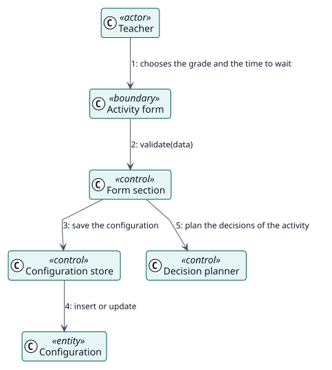

# UC-001 Configure Autograder in an activity — analysis realization

| Overview | Requirements | Analysis | Design | Implementation | Tests |
| --- | --- | --- | --- | --- | --- |
| [Use cases](../../../requirements/use-case-overview.svg) | [Requirements](../../../requirements/use-cases/configureAutograder/README.md) | **Analysis** | [Design](../../../design/use-cases/configureAutograder/README.md) | [Implementation](../../../implementation/use-cases/configureAutograder/README.md) | [Tests](../../../implementation/use-cases/configureAutograder/README.md#tests) |

Requirements: [README](../../../requirements/use-cases/configureAutograder/README.md)

## Participating classes

| Class | Stereotype | Responsibility |
| --- | --- | --- |
| Activity form | boundary | Collects the grade and the time to wait. |
| Form section | control | Validates and saves the section. |
| Configuration store | control | Inserts or updates the configuration. |
| Decision planner | control | Plans the decisions of the activity. |
| Configuration | entity | The settings of the activity. |

## Collaboration

## Notes

The section is added to every activity form through the form hooks of Moodle and is saved after the activity itself.
