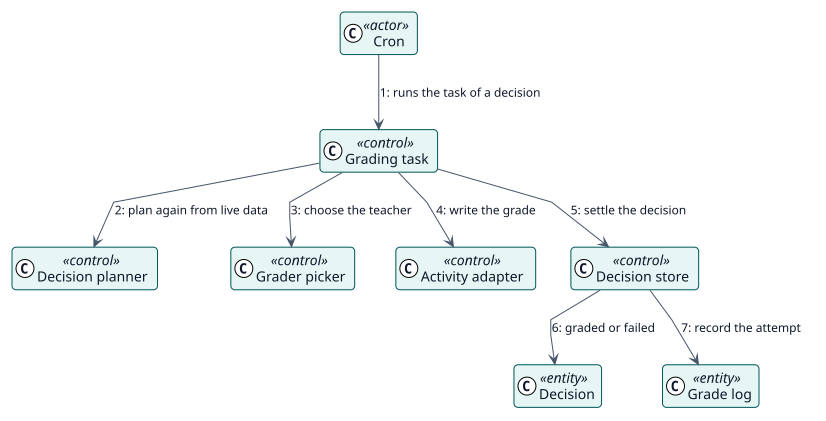

# UC-003 Grade a student — analysis realization

| Overview | Requirements | Analysis | Design | Implementation | Tests |
| --- | --- | --- | --- | --- | --- |
| [Use cases](../../../requirements/use-case-overview.svg) | [Requirements](../../../requirements/use-cases/gradeStudent/README.md) | **Analysis** | [Design](../../../design/use-cases/gradeStudent/README.md) | [Implementation](../../../implementation/use-cases/gradeStudent/README.md) | [Tests](../../../implementation/use-cases/gradeStudent/README.md#tests) |

Requirements: [README](../../../requirements/use-cases/gradeStudent/README.md)

## Participating classes

| Class | Stereotype | Responsibility |
| --- | --- | --- |
| Grading task | control | Checks again and gives the grade. |
| Decision planner | control | Plans again from live data. |
| Grader picker | control | Chooses the teacher. |
| Activity adapter | control | Writes the grade through the activity. |
| Decision store | control | Settles the decision. |
| Decision | entity | The record that is settled. |
| Grade log | entity | The audit trail of the attempt. |

## Collaboration

## Notes

A task that finds its decision already settled does nothing. A missed event costs promptness, never correctness.
