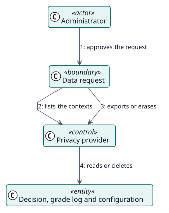

# UC-012 Export or erase personal data — analysis realization

| Overview | Requirements | Analysis | Design | Implementation | Tests |
| --- | --- | --- | --- | --- | --- |
| [Use cases](../../../requirements/use-case-overview.svg) | [Requirements](../../../requirements/use-cases/managePersonalData/README.md) | **Analysis** | [Design](../../../design/use-cases/managePersonalData/README.md) | [Implementation](../../../implementation/use-cases/managePersonalData/README.md) | [Tests](../../../implementation/use-cases/managePersonalData/README.md#tests) |

Requirements: [README](../../../requirements/use-cases/managePersonalData/README.md)

## Participating classes

| Class | Stereotype | Responsibility |
| --- | --- | --- |
| Data request | boundary | Where the administrator approves the request. |
| Privacy provider | control | Lists, exports and erases what the plugin stores. |
| Decision, Grade log, Configuration | entity | The stored data. |

## Collaboration

## Notes

The failure notices go through the messaging of Moodle, which has its own privacy provider.
