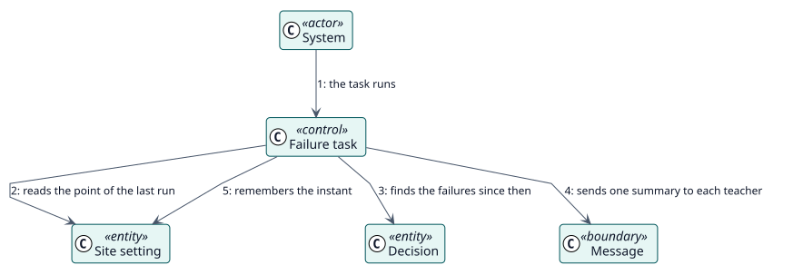

# UC-008 Tell the teachers which students could not be graded — analysis realization

| Overview | Requirements | Analysis | Design | Implementation | Tests |
| --- | --- | --- | --- | --- | --- |
| [Use cases](../../../requirements/use-case-overview.svg) | [Requirements](../../../requirements/use-cases/notifyFailures/README.md) | **Analysis** | [Design](../../../design/use-cases/notifyFailures/README.md) | [Implementation](../../../implementation/use-cases/notifyFailures/README.md) | [Tests](../../../implementation/use-cases/notifyFailures/README.md#tests) |

Requirements: [README](../../../requirements/use-cases/notifyFailures/README.md)

## Participating classes

| Class | Stereotype | Responsibility |
| --- | --- | --- |
| Failure task | control | Finds the failures, groups them and sends the summaries. |
| Decision | entity | The record that failed, with its reason. |
| Site setting | entity | Whether the notices are on and the instant of the last run. |
| Message | boundary | What the teacher reads. |

## Collaboration

## Notes

The summary goes to the people who can act on it, not to the teacher a grade would have been recorded as: a failed decision stores no grader.
