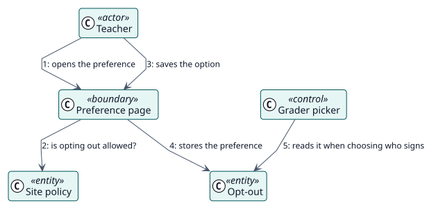

# UC-006 Opt out of having grades recorded in my name — analysis realization

| Overview | Requirements | Analysis | Design | Implementation | Tests |
| --- | --- | --- | --- | --- | --- |
| [Use cases](../../../requirements/use-case-overview.svg) | [Requirements](../../../requirements/use-cases/optOutOfGrading/README.md) | **Analysis** | [Design](../../../design/use-cases/optOutOfGrading/README.md) | [Implementation](../../../implementation/use-cases/optOutOfGrading/README.md) | [Tests](../../../implementation/use-cases/optOutOfGrading/README.md#tests) |

Requirements: [README](../../../requirements/use-cases/optOutOfGrading/README.md)

## Participating classes

| Class | Stereotype | Responsibility |
| --- | --- | --- |
| Preference page | boundary | Shows the option and saves it. |
| Grader picker | control | Leaves out the users who opted out when it chooses who signs. |
| Site policy | entity | Says whether opting out is offered. |
| Opt-out | entity | The preference of the user. |

## Collaboration

## Notes

With few teachers, opt-outs can leave a student with nobody to sign the grade; the fallback grader of the site then signs, and without one the grading fails.
