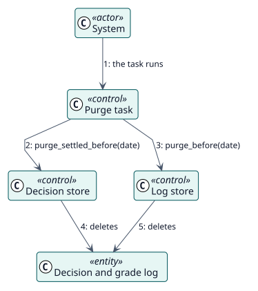

# UC-010 Delete the old history — analysis realization

| Overview | Requirements | Analysis | Design | Implementation | Tests |
| --- | --- | --- | --- | --- | --- |
| [Use cases](../../../requirements/use-case-overview.svg) | [Requirements](../../../requirements/use-cases/purgeHistory/README.md) | **Analysis** | [Design](../../../design/use-cases/purgeHistory/README.md) | [Implementation](../../../implementation/use-cases/purgeHistory/README.md) | [Tests](../../../implementation/use-cases/purgeHistory/README.md#tests) |

Requirements: [README](../../../requirements/use-cases/purgeHistory/README.md)

## Participating classes

| Class | Stereotype | Responsibility |
| --- | --- | --- |
| Purge task | control | Works out the date and asks both stores to delete. |
| Decision store | control | Deletes the settled decisions before the date. |
| Log store | control | Deletes the log entries before the date. |
| Decision, Grade log | entity | What is deleted. |

## Collaboration

## Notes

Failed decisions are deleted too: a retention shorter than the interval of the failure notices would delete failures before they were reported.
