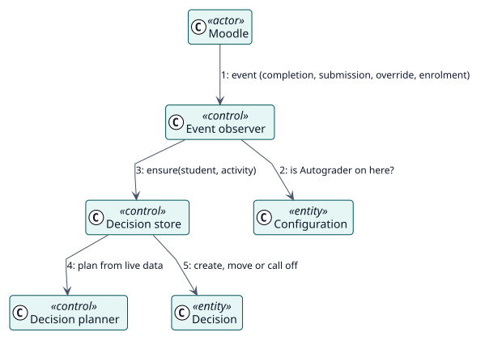

# UC-004 Reconsider a decision when something changes — analysis realization

| Overview | Requirements | Analysis | Design | Implementation | Tests |
| --- | --- | --- | --- | --- | --- |
| [Use cases](../../../requirements/use-case-overview.svg) | [Requirements](../../../requirements/use-cases/reconsiderDecision/README.md) | **Analysis** | [Design](../../../design/use-cases/reconsiderDecision/README.md) | [Implementation](../../../implementation/use-cases/reconsiderDecision/README.md) | [Tests](../../../implementation/use-cases/reconsiderDecision/README.md#tests) |

Requirements: [README](../../../requirements/use-cases/reconsiderDecision/README.md)

## Participating classes

| Class | Stereotype | Responsibility |
| --- | --- | --- |
| Event observer | control | Reacts to the events of the course. |
| Decision planner | control | Plans from live data. |
| Decision store | control | Creates, moves and calls off decisions. |
| Configuration | entity | Tells whether Autograder is on. |
| Decision | entity | The record that follows the course. |

## Collaboration

## Notes

Tasks complete the work of the observers: one recalculates an activity, one catches up the students of an activity and one queues again the tasks that were lost.
