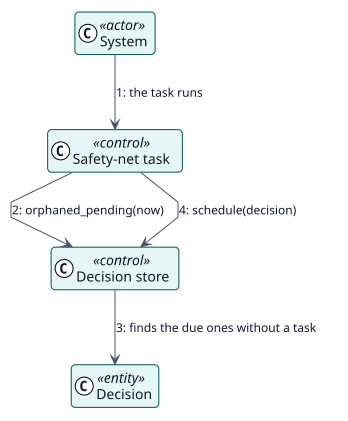

# UC-009 Queue again the grades that lost their task — analysis realization

| Overview | Requirements | Analysis | Design | Implementation | Tests |
| --- | --- | --- | --- | --- | --- |
| [Use cases](../../../requirements/use-case-overview.svg) | [Requirements](../../../requirements/use-cases/requeueLostGrades/README.md) | **Analysis** | [Design](../../../design/use-cases/requeueLostGrades/README.md) | [Implementation](../../../implementation/use-cases/requeueLostGrades/README.md) | [Tests](../../../implementation/use-cases/requeueLostGrades/README.md#tests) |

Requirements: [README](../../../requirements/use-cases/requeueLostGrades/README.md)

## Participating classes

| Class | Stereotype | Responsibility |
| --- | --- | --- |
| Safety-net task | control | Looks for the orphaned decisions and asks to queue them. |
| Decision store | control | Finds the orphaned decisions and schedules their tasks. |
| Decision | entity | The pending record that lost its task. |

## Collaboration

## Notes

The grading task that this one queues checks everything again before it writes a grade.
