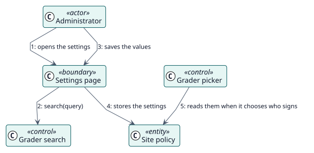

# UC-007 Set the policy of the site — analysis realization

| Overview | Requirements | Analysis | Design | Implementation | Tests |
| --- | --- | --- | --- | --- | --- |
| [Use cases](../../../requirements/use-case-overview.svg) | [Requirements](../../../requirements/use-cases/setSitePolicy/README.md) | **Analysis** | [Design](../../../design/use-cases/setSitePolicy/README.md) | [Implementation](../../../implementation/use-cases/setSitePolicy/README.md) | [Tests](../../../implementation/use-cases/setSitePolicy/README.md#tests) |

Requirements: [README](../../../requirements/use-cases/setSitePolicy/README.md)

## Participating classes

| Class | Stereotype | Responsibility |
| --- | --- | --- |
| Settings page | boundary | Shows and validates the settings. |
| Grader search | control | Finds the users that may be the fallback grader. |
| Grader picker | control | Applies the policy when it chooses who signs. |
| Site policy | entity | The stored settings. |

## Collaboration

## Notes

The search of users is a web-service function that only a user who can change the settings may call.
