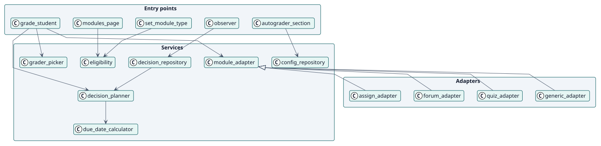
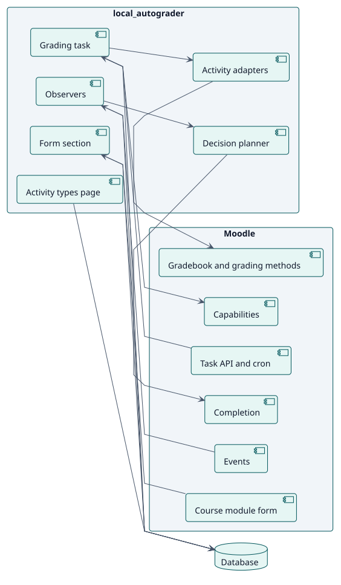
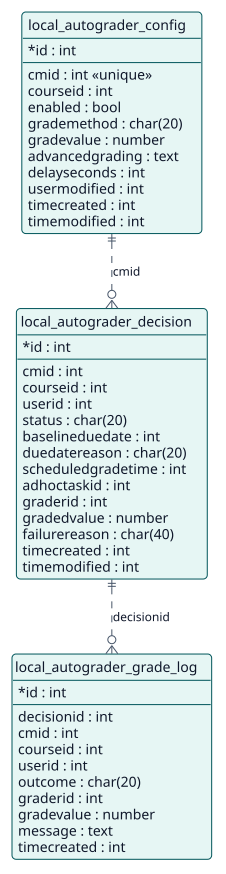

# Design

## Architecture

Autograder is a Moodle local plugin with three layers:

- **Entry points**: the settings section of the activity form, the page of the activity types, the observers of events and the ad hoc and scheduled tasks.
- **Services**: classes in `classes/local/`. `config_repository` and `eligibility` hold the configuration, `decision_planner` and `decision_repository` the decisions, `grader_picker` the choice of teacher and the adapters of `module/` the work through each kind of activity.
- **Persistence**: three tables, `local_autograder_config`, `local_autograder_decision` and `local_autograder_grade_log`.

Two decisions shape the design. First, **every condition is read again when a grade is due**, so an event that is missed or a role that changed costs promptness at most and never correctness. Second, **each grade is its own ad hoc task**, scheduled for its time, with a task that queues again the ones that lost theirs.

## Design classes

## Components

The plugin sits on completion, the gradebook and the grading methods, events, the task API, capabilities and the database of Moodle. It adds no change to core.

## The list of activity types

The list of the page of the activity types is drawn as every list of the Didactika design system: its box takes the height the window leaves it, less what comes under it, and at least 18rem (`amd/src/fit_tables.js`); the line of every row reaches the end of the box and the last row keeps its line (`styles.css`); and the width of each column is kept when a filter changes the rows (`amd/src/modules.js`).

## Data model

## Use-case realizations

| ID | Use case | Sequence |
| --- | --- | --- |
| UC-001 | [Configure Autograder in an activity](./use-cases/configureAutograder/README.md) | [sequence](./use-cases/configureAutograder/sequence.svg) |
| UC-002 | [Choose the activity types](./use-cases/chooseActivityTypes/README.md) | [sequence](./use-cases/chooseActivityTypes/sequence.svg) |
| UC-003 | [Grade a student](./use-cases/gradeStudent/README.md) | [sequence](./use-cases/gradeStudent/sequence.svg) |
| UC-004 | [Reconsider a decision when something changes](./use-cases/reconsiderDecision/README.md) | [sequence](./use-cases/reconsiderDecision/sequence.svg) |
| UC-005 | [Choose the result of a rubric or marking guide](./use-cases/chooseAdvancedGrade/README.md) | [sequence](./use-cases/chooseAdvancedGrade/sequence.svg) |
| UC-006 | [Opt out of having grades recorded in my name](./use-cases/optOutOfGrading/README.md) | [sequence](./use-cases/optOutOfGrading/sequence.svg) |
| UC-007 | [Set the policy of the site](./use-cases/setSitePolicy/README.md) | [sequence](./use-cases/setSitePolicy/sequence.svg) |
| UC-008 | [Tell the teachers which students could not be graded](./use-cases/notifyFailures/README.md) | [sequence](./use-cases/notifyFailures/sequence.svg) |
| UC-009 | [Queue again the grades that lost their task](./use-cases/requeueLostGrades/README.md) | [sequence](./use-cases/requeueLostGrades/sequence.svg) |
| UC-010 | [Delete the old history](./use-cases/purgeHistory/README.md) | [sequence](./use-cases/purgeHistory/sequence.svg) |
| UC-011 | [Carry the configuration in a course backup](./use-cases/carryConfigurationInBackup/README.md) | [sequence](./use-cases/carryConfigurationInBackup/sequence.svg) |
| UC-012 | [Export or erase personal data](./use-cases/managePersonalData/README.md) | [sequence](./use-cases/managePersonalData/sequence.svg) |
