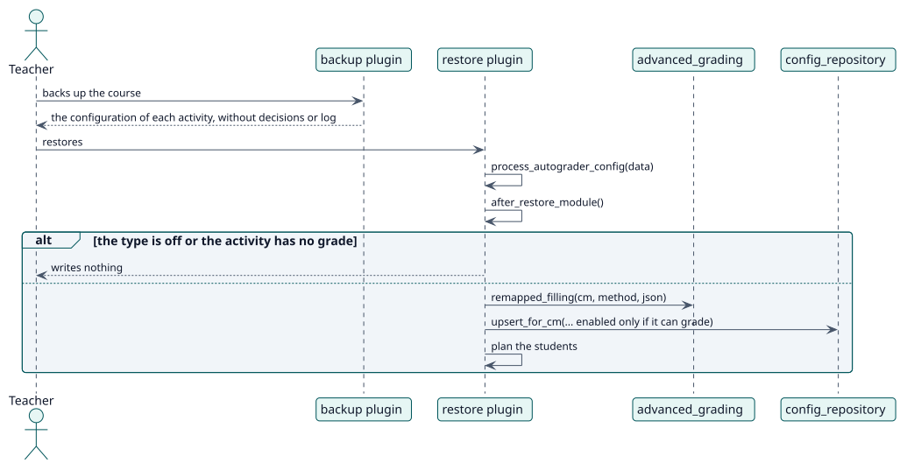

# UC-011 Carry the configuration in a course backup — design realization

| Overview | Requirements | Analysis | Design | Implementation | Tests |
| --- | --- | --- | --- | --- | --- |
| [Use cases](../../../requirements/use-case-overview.svg) | [Requirements](../../../requirements/use-cases/carryConfigurationInBackup/README.md) | [Analysis](../../../analysis/use-cases/carryConfigurationInBackup/README.md) | **Design** | [Implementation](../../../implementation/use-cases/carryConfigurationInBackup/README.md) | [Tests](../../../implementation/use-cases/carryConfigurationInBackup/README.md#tests) |

Analysis: [README](../../../analysis/use-cases/carryConfigurationInBackup/README.md)

## Elements

| Design element | Kind | Code target |
| --- | --- | --- |
| `backup_local_autograder_plugin` | backup | `backup/moodle2/backup_local_autograder_plugin.class.php:49` |
| `restore_local_autograder_plugin::process_autograder_config` | restore | `backup/moodle2/restore_local_autograder_plugin.class.php:80` |
| `restore_local_autograder_plugin::after_restore_module` | restore | `backup/moodle2/restore_local_autograder_plugin.class.php:92` |
| `restore_local_autograder_plugin::remapped_filling` | restore | `backup/moodle2/restore_local_autograder_plugin.class.php:181` |

## Sequence

## Contracts

| Operation | Input | Output | Errors |
| --- | --- | --- | --- |
| Backup and restore of the activity | the configuration of the activity | the configuration of the restored activity | none: what cannot work is restored switched off or not at all |

## Data touched

| Table or entity | Operation |
| --- | --- |
| `local_autograder_config` | read and insert |
| `local_autograder_decision` | insert (planned again) |
