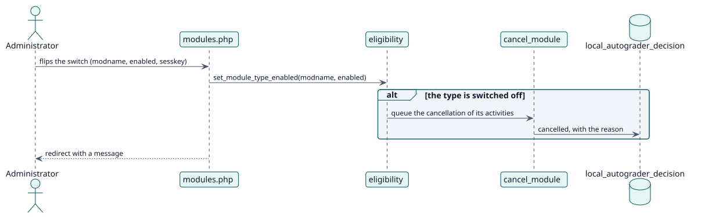

# UC-002 Choose the activity types — design realization

| Overview | Requirements | Analysis | Design | Implementation | Tests |
| --- | --- | --- | --- | --- | --- |
| [Use cases](../../../requirements/use-case-overview.svg) | [Requirements](../../../requirements/use-cases/chooseActivityTypes/README.md) | [Analysis](../../../analysis/use-cases/chooseActivityTypes/README.md) | **Design** | [Implementation](../../../implementation/use-cases/chooseActivityTypes/README.md) | [Tests](../../../implementation/use-cases/chooseActivityTypes/README.md#tests) |

Analysis: [README](../../../analysis/use-cases/chooseActivityTypes/README.md)

## Elements

| Design element | Kind | Code target |
| --- | --- | --- |
| `set_module_type::execute` | service | `classes/external/set_module_type.php:57` |
| `eligibility::set_module_type_enabled` | service | `classes/local/config/eligibility.php:108` |
| `cancel_module` task | task | `classes/task/cancel_module.php:41` |

## Sequence

## Contracts

| Operation | Input | Output | Errors |
| --- | --- | --- | --- |
| `local_autograder_set_module_type(modname, enabled)` | the type and the new state | the saved state | type that cannot be graded, no capability |

## Data touched

| Table or entity | Operation |
| --- | --- |
| `config_plugins` | update (enabled types) |
| `local_autograder_decision` | update (cancelled) |
