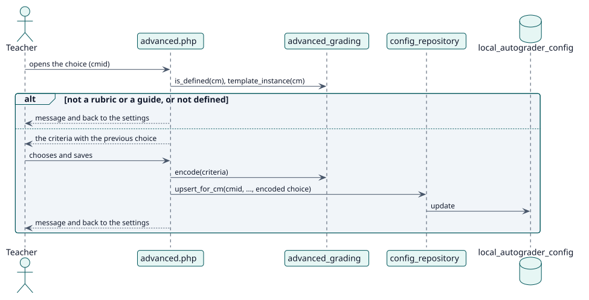

# UC-005 Choose the result of a rubric or marking guide — design realization

| Overview | Requirements | Analysis | Design | Implementation | Tests |
| --- | --- | --- | --- | --- | --- |
| [Use cases](../../../requirements/use-case-overview.svg) | [Requirements](../../../requirements/use-cases/chooseAdvancedGrade/README.md) | [Analysis](../../../analysis/use-cases/chooseAdvancedGrade/README.md) | **Design** | [Implementation](../../../implementation/use-cases/chooseAdvancedGrade/README.md) | [Tests](../../../implementation/use-cases/chooseAdvancedGrade/README.md#tests) |

Analysis: [README](../../../analysis/use-cases/chooseAdvancedGrade/README.md)

## Elements

| Design element | Kind | Code target |
| --- | --- | --- |
| `advanced.php` | page | `advanced.php` |
| `advanced_grading::template_instance` | service | `classes/local/grading/advanced_grading.php:114` |
| `advanced_grading::encode` | service | `classes/local/grading/advanced_grading.php:251` |
| `advanced_grading::filling_is_current` | service | `classes/local/grading/advanced_grading.php:271` |
| `config_repository::upsert_for_cm` | service | `classes/local/config/config_repository.php:101` |
| `config_updated` | event | `classes/event/config_updated.php` |

## Sequence

## Contracts

| Operation | Input | Output | Errors |
| --- | --- | --- | --- |
| `advanced.php?cmid=` | the activity and, on saving, one answer for each criterion | a redirect with a message | no capability, the activity is not graded with a rubric or a guide |

## Data touched

| Table or entity | Operation |
| --- | --- |
| `local_autograder_config` | update (the choice of the result) |
