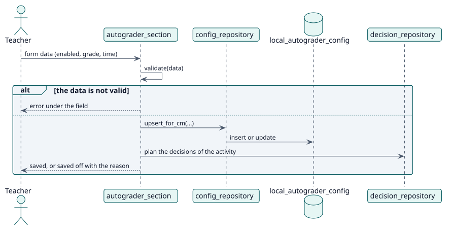

# UC-001 Configure Autograder in an activity — design realization

| Overview | Requirements | Analysis | Design | Implementation | Tests |
| --- | --- | --- | --- | --- | --- |
| [Use cases](../../../requirements/use-case-overview.svg) | [Requirements](../../../requirements/use-cases/configureAutograder/README.md) | [Analysis](../../../analysis/use-cases/configureAutograder/README.md) | **Design** | [Implementation](../../../implementation/use-cases/configureAutograder/README.md) | [Tests](../../../implementation/use-cases/configureAutograder/README.md#tests) |

Analysis: [README](../../../analysis/use-cases/configureAutograder/README.md)

## Elements

| Design element | Kind | Code target |
| --- | --- | --- |
| `autograder_section::validate` | service | `classes/form/autograder_section.php:442` |
| `autograder_section::save` | service | `classes/form/autograder_section.php:729` |
| `config_repository::upsert_for_cm` | service | `classes/local/config/config_repository.php:101` |

## Sequence

## Contracts

| Operation | Input | Output | Errors |
| --- | --- | --- | --- |
| `upsert_for_cm(cmid, courseid, enabled, grademethod, gradevalue, advancedgrading, delayseconds, userid)` | the settings of one activity | the saved record | invalid grade, missing selection |

## Data touched

| Table or entity | Operation |
| --- | --- |
| `local_autograder_config` | insert or update |
| `local_autograder_decision` | insert (planned decisions) |
