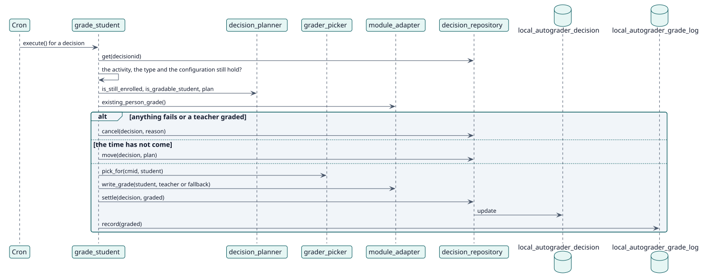

# UC-003 Grade a student — design realization

| Overview | Requirements | Analysis | Design | Implementation | Tests |
| --- | --- | --- | --- | --- | --- |
| [Use cases](../../../requirements/use-case-overview.svg) | [Requirements](../../../requirements/use-cases/gradeStudent/README.md) | [Analysis](../../../analysis/use-cases/gradeStudent/README.md) | **Design** | [Implementation](../../../implementation/use-cases/gradeStudent/README.md) | [Tests](../../../implementation/use-cases/gradeStudent/README.md#tests) |

Analysis: [README](../../../analysis/use-cases/gradeStudent/README.md)

## Elements

| Design element | Kind | Code target |
| --- | --- | --- |
| `grade_student::execute` | task | `classes/task/grade_student.php:56` |
| `grader_picker::pick_for` | service | `classes/local/grading/grader_picker.php:56` |
| `module_adapter::write_grade` | service | `classes/local/module/module_adapter.php:173` |
| `decision_repository::settle` | service | `classes/local/decision/decision_repository.php:413` |

## Sequence

## Contracts

| Operation | Input | Output | Errors |
| --- | --- | --- | --- |
| `write_grade(userid, graderid)` | the student and the teacher | the grade that was posted | refusal of the grade, unsupported grade type |

## Data touched

| Table or entity | Operation |
| --- | --- |
| `local_autograder_decision` | update |
| `local_autograder_grade_log` | insert |
| `grade_grades` | update (through the activity) |
| `logstore_standard_log` | insert (`student_graded`) |
