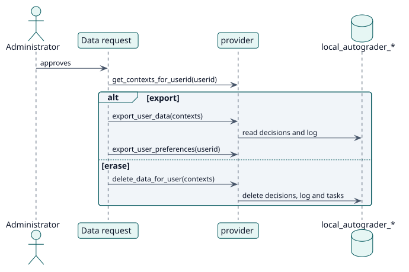

# UC-012 Export or erase personal data — design realization

| Overview | Requirements | Analysis | Design | Implementation | Tests |
| --- | --- | --- | --- | --- | --- |
| [Use cases](../../../requirements/use-case-overview.svg) | [Requirements](../../../requirements/use-cases/managePersonalData/README.md) | [Analysis](../../../analysis/use-cases/managePersonalData/README.md) | **Design** | [Implementation](../../../implementation/use-cases/managePersonalData/README.md) | [Tests](../../../implementation/use-cases/managePersonalData/README.md#tests) |

Analysis: [README](../../../analysis/use-cases/managePersonalData/README.md)

## Elements

| Design element | Kind | Code target |
| --- | --- | --- |
| `provider::get_metadata` | provider | `classes/privacy/provider.php:53` |
| `provider::get_contexts_for_userid` | provider | `classes/privacy/provider.php:111` |
| `provider::export_user_data` | provider | `classes/privacy/provider.php:195` |
| `provider::export_user_preferences` | provider | `classes/privacy/provider.php:285` |
| `provider::delete_data_for_user` | provider | `classes/privacy/provider.php:318` |
| `provider::delete_data_for_all_users_in_context` | provider | `classes/privacy/provider.php:305` |

## Sequence

## Contracts

| Operation | Input | Output | Errors |
| --- | --- | --- | --- |
| `provider::export_user_data(approved_contextlist)` | the contexts approved | the decisions and the log of the user in each activity | none |
| `provider::delete_data_for_user(approved_contextlist)` | the contexts approved | the data deleted | none |

## Data touched

| Table or entity | Operation |
| --- | --- |
| `local_autograder_decision` | read and delete |
| `local_autograder_grade_log` | read and delete |
| `local_autograder_config` | delete (a whole activity) |
| `user_preferences` | read |
