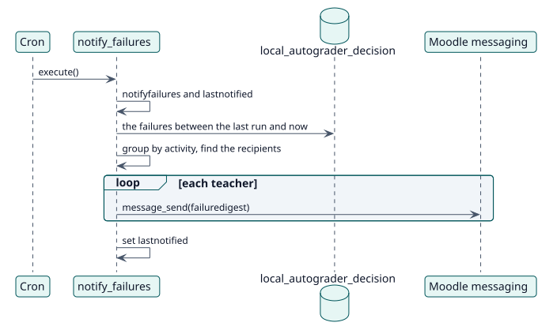

# UC-008 Tell the teachers which students could not be graded — design realization

| Overview | Requirements | Analysis | Design | Implementation | Tests |
| --- | --- | --- | --- | --- | --- |
| [Use cases](../../../requirements/use-case-overview.svg) | [Requirements](../../../requirements/use-cases/notifyFailures/README.md) | [Analysis](../../../analysis/use-cases/notifyFailures/README.md) | **Design** | [Implementation](../../../implementation/use-cases/notifyFailures/README.md) | [Tests](../../../implementation/use-cases/notifyFailures/README.md#tests) |

Analysis: [README](../../../analysis/use-cases/notifyFailures/README.md)

## Elements

| Design element | Kind | Code target |
| --- | --- | --- |
| `notify_failures::execute` | task | `classes/task/notify_failures.php:61` |
| `notify_failures::setting_changed` | service | `classes/task/notify_failures.php:115` |
| `notify_failures::recipients_for` | service | `classes/task/notify_failures.php:216` |
| `notify_failures::send` | service | `classes/task/notify_failures.php:235` |
| Message provider `failuredigest` | message | `db/messages.php` |

## Sequence

## Contracts

| Operation | Input | Output | Errors |
| --- | --- | --- | --- |
| `notify_failures::execute()` | none | one message per teacher concerned | none: a recipient that cannot be reached is skipped |

## Data touched

| Table or entity | Operation |
| --- | --- |
| `local_autograder_decision` | read |
| `config_plugins` (`lastnotified`) | update |
