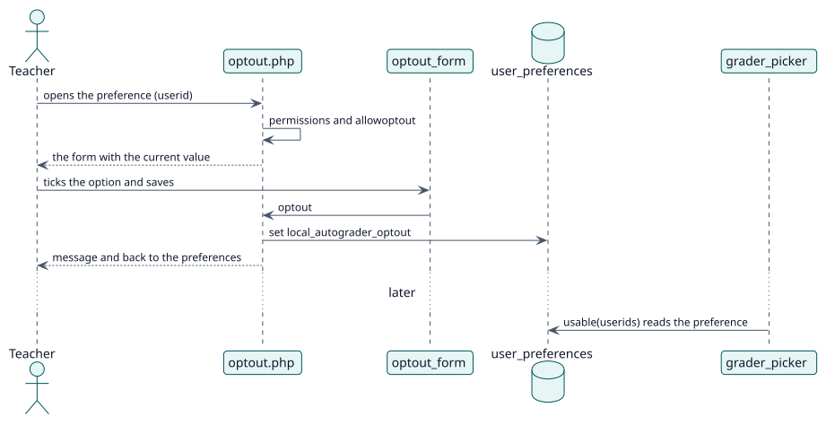

# UC-006 Opt out of having grades recorded in my name — design realization

| Overview | Requirements | Analysis | Design | Implementation | Tests |
| --- | --- | --- | --- | --- | --- |
| [Use cases](../../../requirements/use-case-overview.svg) | [Requirements](../../../requirements/use-cases/optOutOfGrading/README.md) | [Analysis](../../../analysis/use-cases/optOutOfGrading/README.md) | **Design** | [Implementation](../../../implementation/use-cases/optOutOfGrading/README.md) | [Tests](../../../implementation/use-cases/optOutOfGrading/README.md#tests) |

Analysis: [README](../../../analysis/use-cases/optOutOfGrading/README.md)

## Elements

| Design element | Kind | Code target |
| --- | --- | --- |
| `optout.php` | page | `optout.php` |
| `optout_form` | form | `classes/form/optout_form.php` |
| `local_autograder_extend_navigation_user_settings` | hook | `lib.php:76` |
| `local_autograder_user_preferences` | hook | `lib.php:99` |
| `grader_picker::usable` | service | `classes/local/grading/grader_picker.php:96` |

## Sequence

## Contracts

| Operation | Input | Output | Errors |
| --- | --- | --- | --- |
| `optout.php?userid=` | the user and the option | a redirect with a message | the site does not offer it, no permission over the profile |

## Data touched

| Table or entity | Operation |
| --- | --- |
| `user_preferences` (`local_autograder_optout`) | update |
