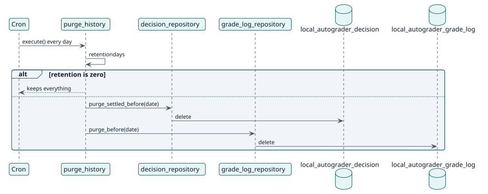

# UC-010 Delete the old history — design realization

| Overview | Requirements | Analysis | Design | Implementation | Tests |
| --- | --- | --- | --- | --- | --- |
| [Use cases](../../../requirements/use-case-overview.svg) | [Requirements](../../../requirements/use-cases/purgeHistory/README.md) | [Analysis](../../../analysis/use-cases/purgeHistory/README.md) | **Design** | [Implementation](../../../implementation/use-cases/purgeHistory/README.md) | [Tests](../../../implementation/use-cases/purgeHistory/README.md#tests) |

Analysis: [README](../../../analysis/use-cases/purgeHistory/README.md)

## Elements

| Design element | Kind | Code target |
| --- | --- | --- |
| `purge_history::execute` | task | `classes/task/purge_history.php:42` |
| `decision_repository::purge_settled_before` | service | `classes/local/decision/decision_repository.php:535` |
| `grade_log_repository::purge_before` | service | `classes/local/grading/grade_log_repository.php:129` |

## Sequence

## Contracts

| Operation | Input | Output | Errors |
| --- | --- | --- | --- |
| `purge_history::execute()` | none | the number of decisions and log entries deleted | none |

## Data touched

| Table or entity | Operation |
| --- | --- |
| `local_autograder_decision` | delete |
| `local_autograder_grade_log` | delete |
