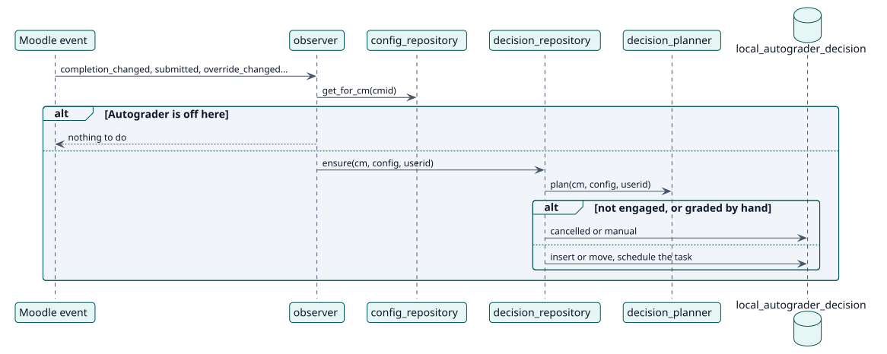

# UC-004 Reconsider a decision when something changes — design realization

| Overview | Requirements | Analysis | Design | Implementation | Tests |
| --- | --- | --- | --- | --- | --- |
| [Use cases](../../../requirements/use-case-overview.svg) | [Requirements](../../../requirements/use-cases/reconsiderDecision/README.md) | [Analysis](../../../analysis/use-cases/reconsiderDecision/README.md) | **Design** | [Implementation](../../../implementation/use-cases/reconsiderDecision/README.md) | [Tests](../../../implementation/use-cases/reconsiderDecision/README.md#tests) |

Analysis: [README](../../../analysis/use-cases/reconsiderDecision/README.md)

## Elements

| Design element | Kind | Code target |
| --- | --- | --- |
| `observer::reconsider` | service | `classes/observer.php:318` |
| `decision_repository::ensure` | service | `classes/local/decision/decision_repository.php:207` |
| `decision_planner::plan` | service | `classes/local/decision/decision_planner.php:62` |
| `reconcile_pending` task | task | `classes/task/reconcile_pending.php:45` |

## Sequence

## Contracts

| Operation | Input | Output | Errors |
| --- | --- | --- | --- |
| `ensure(cm, config, userid)` | the activity, its configuration and the student | the decision, or null | none: it never throws for a student that is not engaged |

## Data touched

| Table or entity | Operation |
| --- | --- |
| `local_autograder_decision` | insert, update |
| `task_adhoc` | insert, delete |
