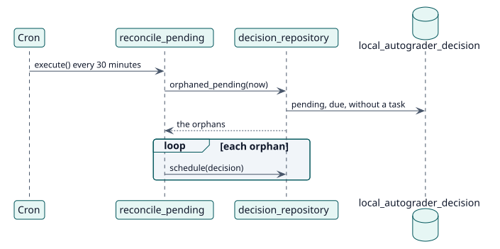

# UC-009 Queue again the grades that lost their task — design realization

| Overview | Requirements | Analysis | Design | Implementation | Tests |
| --- | --- | --- | --- | --- | --- |
| [Use cases](../../../requirements/use-case-overview.svg) | [Requirements](../../../requirements/use-cases/requeueLostGrades/README.md) | [Analysis](../../../analysis/use-cases/requeueLostGrades/README.md) | **Design** | [Implementation](../../../implementation/use-cases/requeueLostGrades/README.md) | [Tests](../../../implementation/use-cases/requeueLostGrades/README.md#tests) |

Analysis: [README](../../../analysis/use-cases/requeueLostGrades/README.md)

## Elements

| Design element | Kind | Code target |
| --- | --- | --- |
| `reconcile_pending::execute` | task | `classes/task/reconcile_pending.php:45` |
| `decision_repository::orphaned_pending` | service | `classes/local/decision/decision_repository.php:172` |
| `decision_repository::schedule` | service | `classes/local/decision/decision_repository.php:362` |

## Sequence

## Contracts

| Operation | Input | Output | Errors |
| --- | --- | --- | --- |
| `reconcile_pending::execute()` | none | a grading task queued for each orphan | none |

## Data touched

| Table or entity | Operation |
| --- | --- |
| `local_autograder_decision` | read |
| `task_adhoc` | insert (the grading tasks) |
