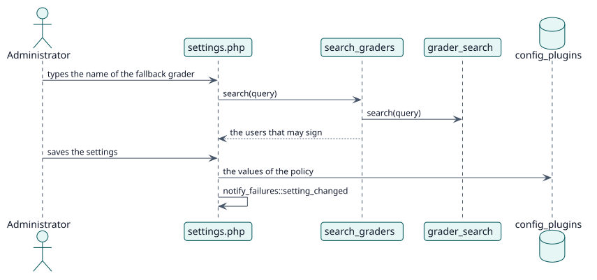

# UC-007 Set the policy of the site — design realization

| Overview | Requirements | Analysis | Design | Implementation | Tests |
| --- | --- | --- | --- | --- | --- |
| [Use cases](../../../requirements/use-case-overview.svg) | [Requirements](../../../requirements/use-cases/setSitePolicy/README.md) | [Analysis](../../../analysis/use-cases/setSitePolicy/README.md) | **Design** | [Implementation](../../../implementation/use-cases/setSitePolicy/README.md) | [Tests](../../../implementation/use-cases/setSitePolicy/README.md#tests) |

Analysis: [README](../../../analysis/use-cases/setSitePolicy/README.md)

## Elements

| Design element | Kind | Code target |
| --- | --- | --- |
| `settings.php` | admin setting | `settings.php` |
| `fallback_grader_setting` | admin setting | `classes/local/config/fallback_grader_setting.php:62` |
| `search_graders::execute` | web service | `classes/external/search_graders.php:73` |
| `grader_search::search` | service | `classes/local/config/grader_search.php:57` |
| `teacher_source::possible_graders_in` | service | `classes/local/grading/teacher_source.php:74` |
| `notify_failures::setting_changed` | service | `classes/task/notify_failures.php:115` |

## Sequence

## Contracts

| Operation | Input | Output | Errors |
| --- | --- | --- | --- |
| `local_autograder_search_graders(query)` | the text typed | the id and the name of each user found | no capability |

## Data touched

| Table or entity | Operation |
| --- | --- |
| `config_plugins` | update (the settings of the plugin) |
