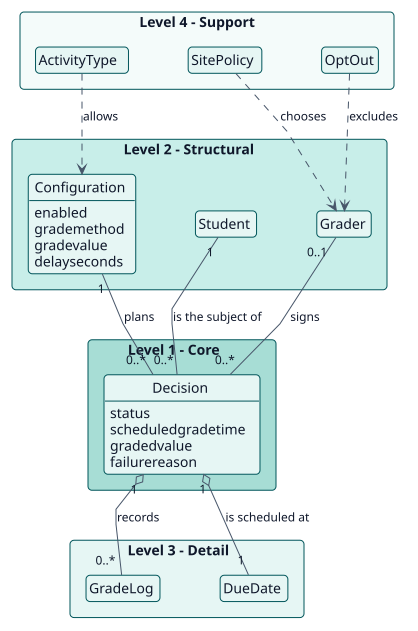
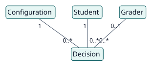
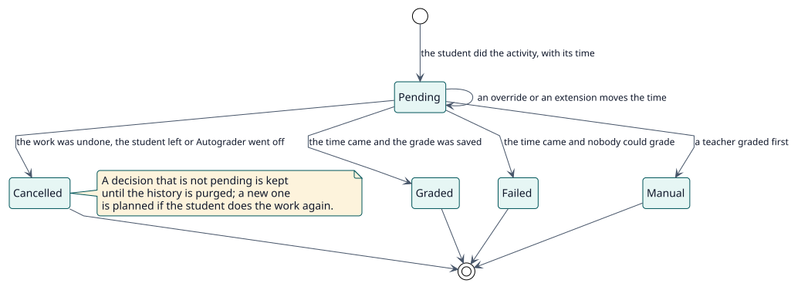

# Domain model

## Purpose

Some activities are assessed on whether students take part, not on the quality of their work. Autograder gives those students the grade a teacher configured, on time, in the name of one of their own teachers, unless a teacher has graded them first. This model names the concepts behind that decision.

## Hierarchy of entities

The vertical position of an entity expresses its importance to the project objective. It is not UML inheritance or composition.

| Level | Meaning | Entities | Why they are here |
| --- | --- | --- | --- |
| 1 | Core: the project cannot exist without them | Decision | The plugin exists to decide, for a student and an activity, whether and when to give a grade. |
| 2 | Structural: depend directly on the core | Configuration, Student, Grader | A decision follows from the configuration of an activity, concerns a student and is signed by a grader. |
| 3 | Detail: qualify or specialise level 2 | GradeLog, DueDate | They describe what happens to a decision: when it is due and what each attempt did. |
| 4 | Support: catalogues, audit, configuration | ActivityType, SitePolicy, OptOut | They bound which activities, which teachers and which settings apply without changing the meaning of a decision. |

## Diagrams

## Entity dictionary

| Entity | Level | Definition | Key attributes | Omitted attributes and why |
| --- | --- | --- | --- | --- |
| Decision | 1 | What Autograder has decided for one student in one activity: wait, grade, cancel or fail. | `status`, `scheduledgradetime`, `graderid`, `gradedvalue`, `failurereason` | Audit columns are in the [data model](../design/data-model/data-model.svg). |
| Configuration | 2 | The settings of Autograder in one activity: whether it is on, the grade to assign and the time to wait. | `enabled`, `grademethod`, `gradevalue`, `advancedgrading`, `delayseconds` | |
| Student | 2 | A person who is enrolled with a role the gradebook grades and who has done the activity. | Moodle user | It is Moodle's `user`, not a table of the plugin. |
| Grader | 2 | The teacher in whose name a grade is recorded, or the fallback grader of the site. | Moodle user | It is Moodle's `user`, not a table of the plugin. |
| GradeLog | 3 | The audit trail of each grading attempt, kept apart from the decision. | `outcome`, `message`, `graderid`, `gradevalue` | |
| DueDate | 3 | The moment a decision is due: the baseline date plus the waiting time. | `baselineduedate`, `duedatereason`, `scheduledgradetime` | It is a set of columns of the decision. |
| ActivityType | 4 | A kind of activity that may use Autograder. | the type name | It is a site setting, not a table. |
| SitePolicy | 4 | The site settings: teaching roles, teacher selection, fallback grader, notifications and history. | `teacher_source_mode`, `tiebreak`, `fallback_grader` | They are plugin settings. |
| OptOut | 4 | The preference of a teacher not to have grades recorded in their name. | user preference | It is a user preference, not a table. |

## Business rules

| ID | Rule | Entities | Source |
| --- | --- | --- | --- |
| RN-001 | A student is graded only after doing the activity: by meeting its completion conditions, ignoring those that ask for a grade, or by handing something in where completion is not tracked. | Student, Decision | `decision_planner::engagement` |
| RN-002 | A grade is due at the baseline date plus the waiting time. The baseline is the close date, a user override, the latest group override or, without a close date, the moment the student finished. | DueDate | `due_date_calculator::calculate` |
| RN-003 | A grade given by a teacher always wins: Autograder never overwrites it and a graded student is never graded again. | Decision | `grade_student::execute` |
| RN-004 | The grade is recorded in the name of a teacher of the student who may grade the activity and see the student; the teacher who shares most groups is preferred. Without one, the fallback grader signs; without that, the grading fails. | Grader | `grader_picker::pick_for` |
| RN-005 | Everything that matters is checked again when the grade is due: the activity, its type, its configuration, the enrolment and the role of the student. | Decision | `grade_student::execute` |
| RN-006 | There is one decision per student and activity; a decision that is graded, failed, manual or cancelled is final until a new one is planned. | Decision | `decision_repository::ensure` |
| RN-007 | Turning Autograder off in an activity, or the type of the activity off on the site, cancels the grades still pending. | Configuration, ActivityType | `cancel_module`, `eligibility::set_module_type_enabled` |
| RN-008 | A quiz that grades itself keeps its own grade: Autograder only grades while a question waits to be marked by hand and gives the gradebook back afterwards. | Decision | `observer::hand_back` |
| RN-009 | Finished decisions and log entries older than the retention setting are deleted daily. | Decision, GradeLog | `purge_history` |

## Lifecycles

### Decision

