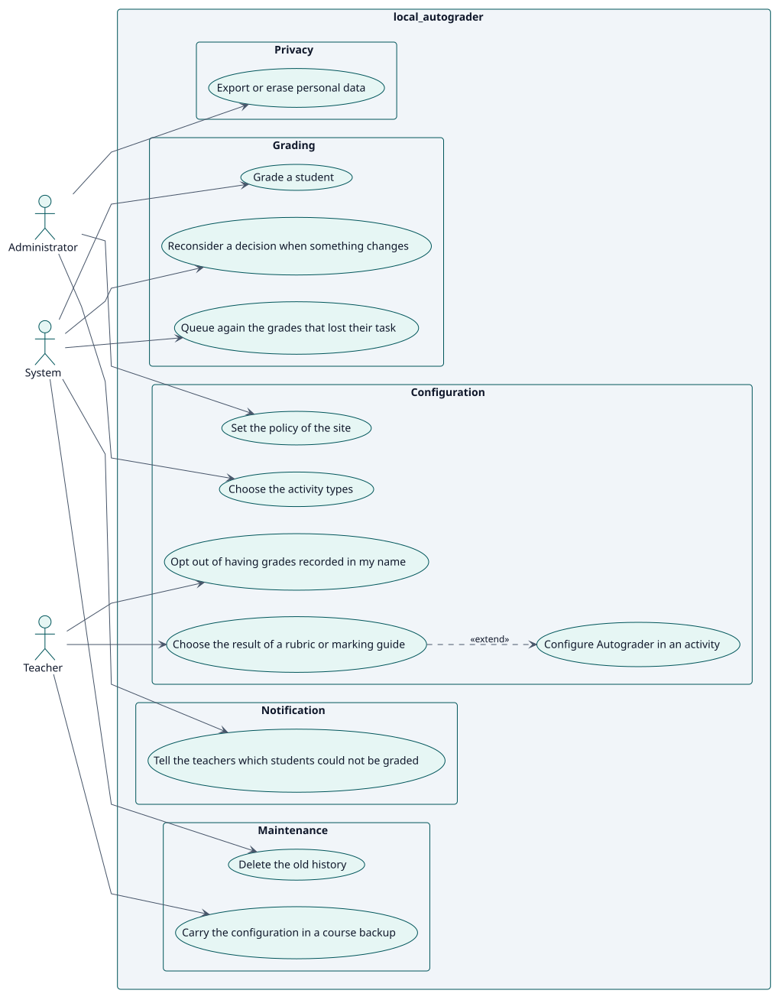
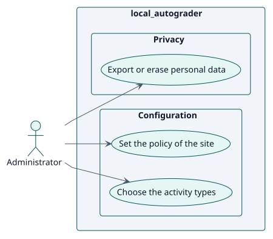
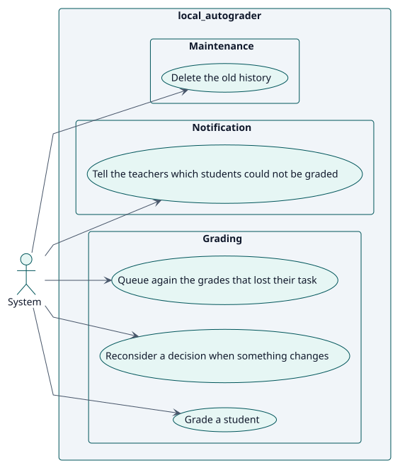
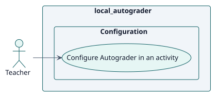

# Requirements

## Index

- [Actors](./actors.md)
- [Requirements catalogue](./requirements.md)

## Use cases

<!-- rup-flow:use-cases:start -->

| ID | Use case | Actor | Package | Requirement | Analysis | Design | Implementation | Status |
| --- | --- | --- | --- | --- | --- | --- | --- | --- |
| UC-001 | [Configure Autograder in an activity](./use-cases/configureAutograder/README.md) | Teacher | Configuration | RF-001 | [card](../analysis/use-cases/configureAutograder/README.md) | [card](../design/use-cases/configureAutograder/README.md) | [card](../implementation/use-cases/configureAutograder/README.md) | draft |
| UC-002 | [Choose the activity types](./use-cases/chooseActivityTypes/README.md) | Administrator | Configuration | RF-002 | [card](../analysis/use-cases/chooseActivityTypes/README.md) | [card](../design/use-cases/chooseActivityTypes/README.md) | [card](../implementation/use-cases/chooseActivityTypes/README.md) | draft |
| UC-003 | [Grade a student](./use-cases/gradeStudent/README.md) | System | Grading | RF-003 | [card](../analysis/use-cases/gradeStudent/README.md) | [card](../design/use-cases/gradeStudent/README.md) | [card](../implementation/use-cases/gradeStudent/README.md) | draft |
| UC-004 | [Reconsider a decision when something changes](./use-cases/reconsiderDecision/README.md) | System | Grading | RF-004 | [card](../analysis/use-cases/reconsiderDecision/README.md) | [card](../design/use-cases/reconsiderDecision/README.md) | [card](../implementation/use-cases/reconsiderDecision/README.md) | draft |

### Use-case diagram

### By actor

#### Administrator

#### System

#### Teacher

<!-- rup-flow:use-cases:end -->

The index and its diagrams are generated from the use-case cards by the `index` command. Edit the cards (front matter: `actor`, `package`, `includes`, `extends`), not this block.

## Conventions

- `specification.puml` is the behavioural source of truth of a use case: a statechart with the Actor/System conversation.
- `wireframes.puml` is the interface prototype, even when it holds a single screen.
- Each use-case folder holds `README.md`, `specification.puml` and `wireframes.puml`.
