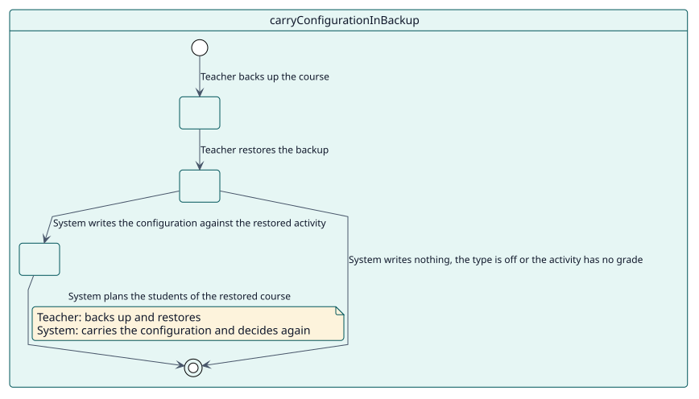
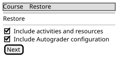

# UC-011 Carry the configuration in a course backup

| Overview | Requirements | Analysis | Design | Implementation | Tests |
| --- | --- | --- | --- | --- | --- |
| [Use cases](../../use-case-overview.svg) | **Requirements** | [Analysis](../../../analysis/use-cases/carryConfigurationInBackup/README.md) | [Design](../../../design/use-cases/carryConfigurationInBackup/README.md) | [Implementation](../../../implementation/use-cases/carryConfigurationInBackup/README.md) | [Tests](../../../implementation/use-cases/carryConfigurationInBackup/README.md#tests) |

## Use-case information

| Field | Value |
| --- | --- |
| Actor | Teacher |
| Package | Maintenance |
| Goal | Back up and restore an activity with its Autograder configuration. |
| Type | Primary, essential |
| Level | User goal |
| Requirement | RF-011 |
| Domain entities | Configuration, Decision |

## Context

The configuration that a teacher chose is part of the activity and goes with it when the course is backed up, duplicated or imported. The decisions and the log do not: they depend on the completions, submissions and enrolments of the course, so the restored course decides again.

## Preconditions

- The user can back up and restore the course.

## Postconditions

- Success: the restored activity has its configuration and Autograder decides what it owes each student.
- Failure: a configuration that cannot work in the restored activity comes back switched off.

## Main flow

| Step | Actor | System |
| --- | --- | --- |
| 1 | Backs up the course or the activity. | Adds the configuration of each activity to its data; leaves the decisions and the log out. |
| 2 | Restores the backup. | Holds the configuration until the activity, its grade item and its grading form exist. |
| 3 |  | Writes the configuration against the restored activity, with the choice of a rubric or guide carried over to the restored criteria. |
| 4 |  | Plans the students of the restored course. |

## Alternative flows

| ID | Starts at step | Condition | Behaviour | Ends |
| --- | --- | --- | --- | --- |
| A1 | 3 | The type of the activity is not enabled on this site. | Writes no configuration. | End |
| A2 | 3 | The activity came back without a grade. | Writes no configuration. | End |
| A3 | 3 | The grade or the choice could not be carried over. | Writes the configuration switched off, so that the teacher meets the notice of the form. | Step 4 |

## Business rules

| ID | Rule |
| --- | --- |
| RN-014 | The configuration travels in a course backup and the decisions and the log do not. It is restored switched on only where there is something to grade with, and the students are decided again. |

## Specification

Behaviour source of truth: [specification.puml](./specification.puml)

## Wireframes

