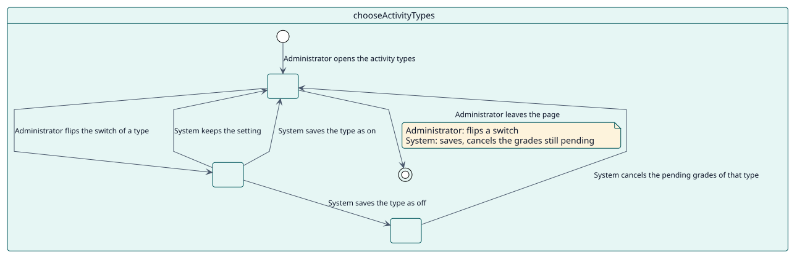
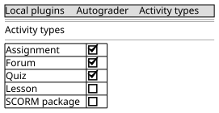

# UC-002 Choose the activity types

| Overview | Requirements | Analysis | Design | Implementation | Tests |
| --- | --- | --- | --- | --- | --- |
| [Use cases](../../use-case-overview.svg) | **Requirements** | [Analysis](../../../analysis/use-cases/chooseActivityTypes/README.md) | [Design](../../../design/use-cases/chooseActivityTypes/README.md) | [Implementation](../../../implementation/use-cases/chooseActivityTypes/README.md) | [Tests](../../../implementation/use-cases/chooseActivityTypes/README.md#tests) |

## Use-case information

| Field | Value |
| --- | --- |
| Actor | Administrator |
| Package | Configuration |
| Goal | Decide which kinds of activity may use Autograder. |
| Type | Primary, essential |
| Level | User goal |
| Requirement | RF-002 |
| Domain entities | ActivityType, Configuration, Decision |

## Context

The site decides which activity types Autograder may grade. A type that is switched off hides the settings and stops the grades that were waiting.

## Preconditions

- The administrator holds `local/autograder:manage`.

## Postconditions

- Success: the type is saved as on or off and, when off, its pending grades are cancelled.
- Failure: the setting stays as it was.

## Main flow

| Step | Actor | System |
| --- | --- | --- |
| 1 | Opens **Activity types** from the settings of the plugin. | Lists every type that can be graded, with its switch. |
| 2 | Flips the switch of a type. | Saves it at once: the page posts the switch and shows a message. |
| 3 |  | When the type goes off, queues the cancellation of the pending grades of its activities. |
| 4 |  | Shows a message with the result. |

## Alternative flows

| ID | Starts at step | Condition | Behaviour | Ends |
| --- | --- | --- | --- | --- |
| A1 | 2 | The type cannot be graded. | Leaves the setting as it is. | Step 1 |

## Business rules

| ID | Rule |
| --- | --- |
| RN-007 | Turning the type of an activity off on the site cancels the grades still pending. |

## Specification

Behaviour source of truth: [specification.puml](./specification.puml)

## Wireframes

