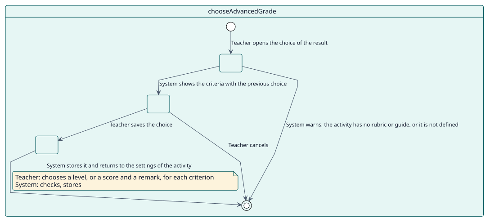
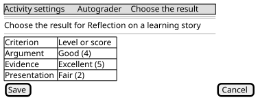

# UC-005 Choose the result of a rubric or marking guide

| Overview | Requirements | Analysis | Design | Implementation | Tests |
| --- | --- | --- | --- | --- | --- |
| [Use cases](../../use-case-overview.svg) | **Requirements** | [Analysis](../../../analysis/use-cases/chooseAdvancedGrade/README.md) | [Design](../../../design/use-cases/chooseAdvancedGrade/README.md) | [Implementation](../../../implementation/use-cases/chooseAdvancedGrade/README.md) | [Tests](../../../implementation/use-cases/chooseAdvancedGrade/README.md#tests) |

## Use-case information

| Field | Value |
| --- | --- |
| Actor | Teacher |
| Package | Configuration |
| Goal | Choose the level of each criterion of the rubric, or the score and remark of each criterion of the marking guide, that Autograder gives. |
| Type | Primary, essential |
| Level | User goal |
| Requirement | RF-006 |
| Domain entities | Configuration, Decision |

## Context

A rubric or a marking guide does not give one number. The teacher fills the form once, as if grading one student, and Autograder gives that result to every student it grades in the activity.

## Preconditions

- The teacher holds `local/autograder:configure` in the activity.
- The activity is graded with a rubric or a marking guide that is already defined.

## Postconditions

- Success: the chosen result is saved with the configuration of the activity.
- Failure: nothing changes and the teacher goes back to the settings of the activity with a message.

## Main flow

| Step | Actor | System |
| --- | --- | --- |
| 1 | Opens the choice of the result from the Autograder section of the settings of the activity. | Checks the capability, the grading method and that the form is defined, and shows the criteria with the previous choice. |
| 2 | Chooses a level, or a score and a remark, for each criterion. | Validates the answers against the definition of the form. |
| 3 | Saves. | Stores the choice, records that the configuration was updated and returns to the settings of the activity with a message. |

## Alternative flows

| ID | Starts at step | Condition | Behaviour | Ends |
| --- | --- | --- | --- | --- |
| A1 | 1 | The activity is not graded with a rubric or a marking guide. | Warns and returns to the settings of the activity. | End |
| A2 | 1 | The rubric or the marking guide is not defined yet. | Sends the teacher to define it, with a message. | End |
| A3 | 2 | The teacher cancels. | Returns to the settings without saving. | End |

## Business rules

| ID | Rule |
| --- | --- |
| RN-017 | The result of a rubric or a marking guide is used only while it still matches the definition: every criterion answered and every answer one that the definition offers. |

## Specification

Behaviour source of truth: [specification.puml](./specification.puml)

## Wireframes

