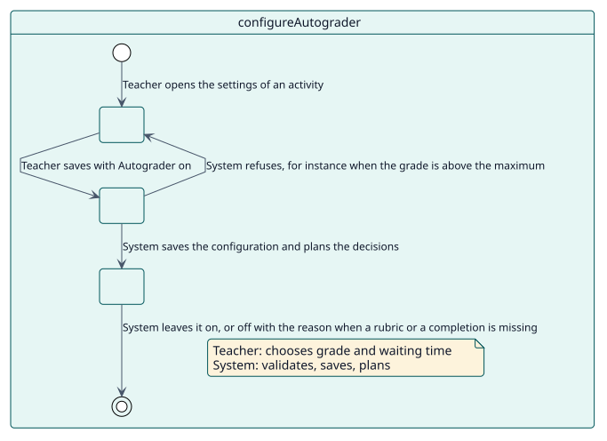
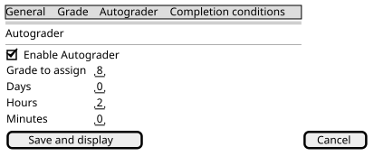

# UC-001 Configure Autograder in an activity

| Overview | Requirements | Analysis | Design | Implementation | Tests |
| --- | --- | --- | --- | --- | --- |
| [Use cases](../../use-case-overview.svg) | **Requirements** | [Analysis](../../../analysis/use-cases/configureAutograder/README.md) | [Design](../../../design/use-cases/configureAutograder/README.md) | [Implementation](../../../implementation/use-cases/configureAutograder/README.md) | [Tests](../../../implementation/use-cases/configureAutograder/README.md#tests) |

## Use-case information

| Field | Value |
| --- | --- |
| Actor | Teacher |
| Package | Configuration |
| Goal | Turn Autograder on in an activity and choose the grade and the waiting time. |
| Type | Primary, essential |
| Level | User goal |
| Requirement | RF-001 |
| Domain entities | Configuration, Decision |

## Context

A teacher decides, activity by activity, whether students who took part are graded automatically, with which grade and how long after the deadline.

## Preconditions

- The teacher holds `local/autograder:configure` in the activity.
- The type of the activity is enabled on the site and the activity is graded.

## Postconditions

- Success: the configuration is saved and the decisions of the activity are planned.
- Failure: nothing is saved and the form shows what to fix, or Autograder is left off with the reason.

## Main flow

| Step | Actor | System |
| --- | --- | --- |
| 1 | Opens the settings of the activity and turns **Enable Autograder** on. | Shows the grade field that matches the grade type of the activity. |
| 2 | Chooses the grade to assign and the time to wait, and saves. | Validates the grade, the maximum and the time. |
| 3 |  | Saves the configuration in `local_autograder_config` and triggers the event of creation or update. |
| 4 |  | Plans the decision of each student who already did the activity. |

## Alternative flows

| ID | Starts at step | Condition | Behaviour | Ends |
| --- | --- | --- | --- | --- |
| A1 | 2 | The grade is empty, negative or above the maximum. | Shows the error under the field; nothing is saved. | Step 1 |
| A2 | 3 | The activity uses a rubric or a marking guide with no selection. | Saves Autograder off and links to the selection. | Step 4 |
| A3 | 3 | The type needs completion and has no condition the student can meet. | Saves Autograder off and says why. | Step 4 |

## Business rules

| ID | Rule |
| --- | --- |
| RN-007 | Turning Autograder off in an activity cancels the grades still pending. |

## Specification

Behaviour source of truth: [specification.puml](./specification.puml)

## Wireframes

