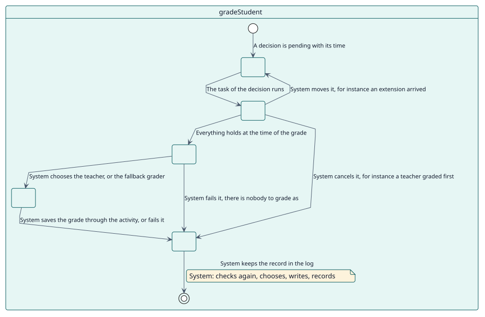
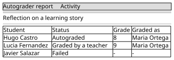

# UC-003 Grade a student

| Overview | Requirements | Analysis | Design | Implementation | Tests |
| --- | --- | --- | --- | --- | --- |
| [Use cases](../../use-case-overview.svg) | **Requirements** | [Analysis](../../../analysis/use-cases/gradeStudent/README.md) | [Design](../../../design/use-cases/gradeStudent/README.md) | [Implementation](../../../implementation/use-cases/gradeStudent/README.md) | [Tests](../../../implementation/use-cases/gradeStudent/README.md#tests) |

## Use-case information

| Field | Value |
| --- | --- |
| Actor | System |
| Package | Grading |
| Goal | Give the configured grade at the time it is due, in the name of one of the teachers of the student. |
| Type | Primary, essential |
| Level | User goal |
| Requirement | RF-003 |
| Domain entities | Decision, Configuration, Student, Grader, GradeLog |

## Context

Each decision has its own ad hoc task, scheduled for the moment it is due. When it runs, it reads every condition again and either gives the grade, moves the decision, cancels it or fails it.

## Preconditions

- The decision is pending and its task is queued.
- Cron is running.

## Postconditions

- Success: the grade is saved through the activity in the name of a teacher or of the fallback grader, and the attempt is logged.
- Failure: the decision is cancelled, moved or failed with its reason, and nothing is overwritten.

## Main flow

| Step | Actor | System |
| --- | --- | --- |
| 1 |  | Reads the decision and checks that the activity, its type, its configuration, the enrolment and the role of the student still hold. |
| 2 |  | Plans again from live data and checks that no teacher has graded the student. |
| 3 |  | Chooses the teacher; without one, uses the fallback grader. |
| 4 |  | Writes the grade through the adapter of the activity. |
| 5 |  | Settles the decision as graded, records the attempt in the log and triggers `student_graded`. |

## Alternative flows

| ID | Starts at step | Condition | Behaviour | Ends |
| --- | --- | --- | --- | --- |
| A1 | 1 | The activity, the type, the configuration, the enrolment or the role no longer hold. | Cancels the decision with the reason. | End |
| A2 | 2 | A teacher graded the student. | Cancels the decision as manual. | End |
| A3 | 2 | An extension moved the time. | Moves the decision and comes back later. | End |
| A4 | 3 | There is no teacher and no fallback grader. | Fails the decision with `no_grader`. | End |
| A5 | 4 | The teacher is refused. | Tries once with the fallback grader; if it is refused too, fails with `grade_write_failed`. | End |

## Business rules

| ID | Rule |
| --- | --- |
| RN-003 | A grade given by a teacher always wins. |
| RN-004 | The grade is recorded in the name of a teacher of the student who may grade; otherwise the fallback grader. |
| RN-005 | Everything that matters is checked again when the grade is due. |

## Specification

Behaviour source of truth: [specification.puml](./specification.puml)

## Wireframes

