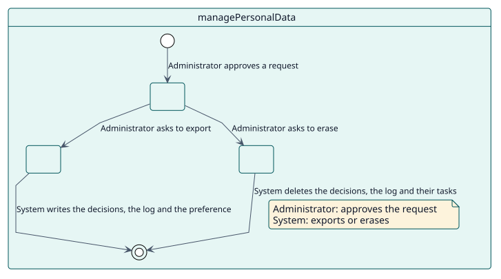
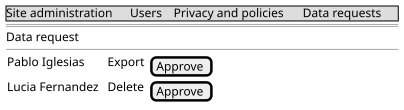

# UC-012 Export or erase personal data

| Overview | Requirements | Analysis | Design | Implementation | Tests |
| --- | --- | --- | --- | --- | --- |
| [Use cases](../../use-case-overview.svg) | **Requirements** | [Analysis](../../../analysis/use-cases/managePersonalData/README.md) | [Design](../../../design/use-cases/managePersonalData/README.md) | [Implementation](../../../implementation/use-cases/managePersonalData/README.md) | [Tests](../../../implementation/use-cases/managePersonalData/README.md#tests) |

## Use-case information

| Field | Value |
| --- | --- |
| Actor | Administrator |
| Package | Privacy |
| Goal | Answer a request of a user to export or erase what Autograder stores about them. |
| Type | Primary, essential |
| Level | User goal |
| Requirement | RF-012 |
| Domain entities | Decision, GradeLog, Configuration, OptOut |

## Context

Autograder stores, for each student and activity, the decision and the log of the grade, and for each teacher the grades recorded in their name and their opt-out preference. It implements the privacy API of Moodle, which the data requests of the site use.

## Preconditions

- The administrator or the data protection officer can manage data requests.

## Postconditions

- Success: the data of the user is exported, or erased where it is stored.
- Failure: an unsupported context is ignored.

## Main flow

| Step | Actor | System |
| --- | --- | --- |
| 1 | Approves a request for a user. | Lists the activities where Autograder holds data about the user. |
| 2 | Exports the data. | Writes the decisions and the log of the user in each activity, and their opt-out preference. |
| 3 | Erases the data. | Deletes the decisions and the log of the user, and the tasks behind them; for a whole activity, also its configuration. |

## Alternative flows

| ID | Starts at step | Condition | Behaviour | Ends |
| --- | --- | --- | --- | --- |
| A1 | 2 | The context is not an activity. | Ignores it. | End |

## Business rules

| ID | Rule |
| --- | --- |
| RN-015 | The decisions and the log of a user can be exported and erased through the privacy API; erasing a whole activity also removes its configuration. |

## Specification

Behaviour source of truth: [specification.puml](./specification.puml)

## Wireframes

