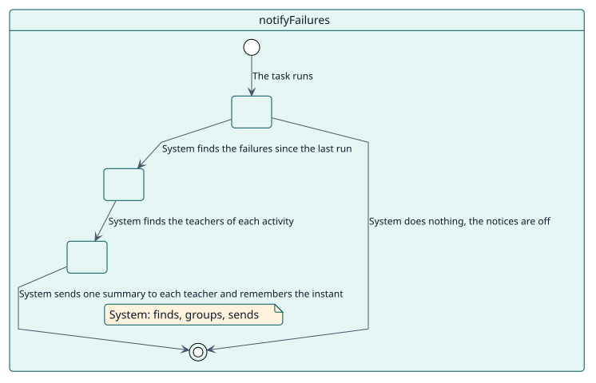
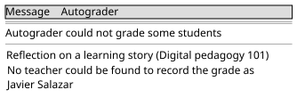

# UC-008 Tell the teachers which students could not be graded

| Overview | Requirements | Analysis | Design | Implementation | Tests |
| --- | --- | --- | --- | --- | --- |
| [Use cases](../../use-case-overview.svg) | **Requirements** | [Analysis](../../../analysis/use-cases/notifyFailures/README.md) | [Design](../../../design/use-cases/notifyFailures/README.md) | [Implementation](../../../implementation/use-cases/notifyFailures/README.md) | [Tests](../../../implementation/use-cases/notifyFailures/README.md#tests) |

## Use-case information

| Field | Value |
| --- | --- |
| Actor | System |
| Package | Notification |
| Goal | Send each teacher concerned one summary of the students that Autograder failed to grade since the last time. |
| Type | Primary, essential |
| Level | User goal |
| Requirement | RF-005 |
| Domain entities | Decision, Configuration, Grader |

## Context

A grading fails when a student comes due, while nobody is looking. Without a notice, the teacher finds out when somebody asks why a student has no grade. The task runs every Monday morning by default, a schedule that the administrator can change, and sends a summary only when the site switched the notices on.

## Preconditions

- The notices of failures are switched on in the settings.

## Postconditions

- Success: each teacher concerned receives one message with the activities that failed since the last run, and the point reached is remembered.
- Failure: a failure that falls between two runs is reported by the next one.

## Main flow

| Step | Actor | System |
| --- | --- | --- |
| 1 |  | Runs and reads the point reached by the last run. |
| 2 |  | Looks for the decisions that failed after that point and before now. |
| 3 |  | Groups them by activity and finds who is enrolled in the course and can configure Autograder in it. |
| 4 | Receives the message by the channel of its choice. | Sends one message per teacher, with a link to the settings of each activity and the reason of each failure. |
| 5 |  | Remembers the instant of the run. |

## Alternative flows

| ID | Starts at step | Condition | Behaviour | Ends |
| --- | --- | --- | --- | --- |
| A1 | 1 | The notices are switched off. | Does nothing. | End |
| A2 | 1 | The task never ran and the setting was not saved through the administration. | Starts the count at this moment and sends nothing. | End |
| A3 | 4 | A recipient is deleted or suspended. | Sends nothing to that user. | Step 5 |
| A4 | 4 | A message lists more than twenty activities. | Lists twenty and sums up the rest. | Step 5 |

## Business rules

| ID | Rule |
| --- | --- |
| RN-012 | Each failure is reported once, grouped by activity, to the people enrolled in the course who can configure Autograder in the activity. |
| RN-009 | Finished decisions older than the retention setting are deleted daily, so a retention shorter than the interval of this task would purge failures before they were reported. |

## Specification

Behaviour source of truth: [specification.puml](./specification.puml)

## Wireframes

