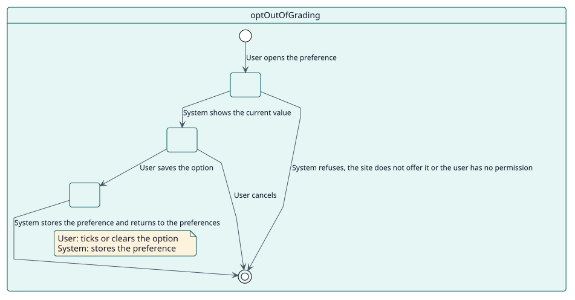
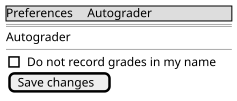

# UC-006 Opt out of having grades recorded in my name

| Overview | Requirements | Analysis | Design | Implementation | Tests |
| --- | --- | --- | --- | --- | --- |
| [Use cases](../../use-case-overview.svg) | **Requirements** | [Analysis](../../../analysis/use-cases/optOutOfGrading/README.md) | [Design](../../../design/use-cases/optOutOfGrading/README.md) | [Implementation](../../../implementation/use-cases/optOutOfGrading/README.md) | [Tests](../../../implementation/use-cases/optOutOfGrading/README.md#tests) |

## Use-case information

| Field | Value |
| --- | --- |
| Actor | Teacher |
| Package | Configuration |
| Goal | Ask that Autograder never records a grade in the name of the user. |
| Type | Primary, essential |
| Level | User goal |
| Requirement | RF-007 |
| Domain entities | OptOut, Grader, SitePolicy |

## Context

Autograder records each grade in the name of a teacher of the student. A teacher who does not want to sign grades given by Autograder can say so in their preferences, when the site offers it.

## Preconditions

- The site allows opting out.
- The user may edit their own profile, or the profile of the user, with `moodle/user:editownprofile` or `moodle/user:editprofile`.

## Postconditions

- Success: the preference is saved and the user is no longer chosen to sign grades.
- Failure: the page is refused and the preference stays as it was.

## Main flow

| Step | Actor | System |
| --- | --- | --- |
| 1 | Opens **Autograder** from the preferences of the user. | Checks the permissions and that the site offers the preference, and shows the form with the current value. |
| 2 | Ticks or clears the option and saves. | Stores the preference and returns to the preferences with a message. |
| 3 |  | From then on, leaves the user out of the teachers that can sign a grade, while the site allows opting out. |

## Alternative flows

| ID | Starts at step | Condition | Behaviour | Ends |
| --- | --- | --- | --- | --- |
| A1 | 1 | The site does not offer the preference. | Refuses the page with a message, even if its address is typed. | End |
| A2 | 1 | The user has no permission over that profile. | Refuses the page. | End |
| A3 | 2 | The user cancels. | Returns to the preferences without saving. | End |

## Business rules

| ID | Rule |
| --- | --- |
| RN-011 | A teacher who opted out is never chosen to sign a grade, but only while the site allows opting out. |

## Specification

Behaviour source of truth: [specification.puml](./specification.puml)

## Wireframes

