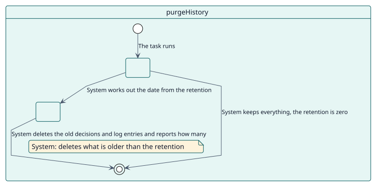
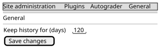

# UC-010 Delete the old history

| Overview | Requirements | Analysis | Design | Implementation | Tests |
| --- | --- | --- | --- | --- | --- |
| [Use cases](../../use-case-overview.svg) | **Requirements** | [Analysis](../../../analysis/use-cases/purgeHistory/README.md) | [Design](../../../design/use-cases/purgeHistory/README.md) | [Implementation](../../../implementation/use-cases/purgeHistory/README.md) | [Tests](../../../implementation/use-cases/purgeHistory/README.md#tests) |

## Use-case information

| Field | Value |
| --- | --- |
| Actor | System |
| Package | Maintenance |
| Goal | Delete the finished decisions and the log entries that are older than the retention of the site. |
| Type | Primary, essential |
| Level | User goal |
| Requirement | RF-010 |
| Domain entities | Decision, GradeLog, SitePolicy |

## Context

The decisions and the log of grades grow with every student and activity. The site chooses how many days it keeps them, and a task deletes the older ones once a day. Pending decisions are never deleted.

## Preconditions

- The retention is greater than zero.

## Postconditions

- Success: the settled decisions and the log entries older than the retention are gone.
- Failure: with a retention of zero, nothing is deleted.

## Main flow

| Step | Actor | System |
| --- | --- | --- |
| 1 |  | Runs every day at 03:30 and reads the retention in days. |
| 2 |  | Deletes the decisions that are settled (graded, cancelled, failed or manual) from before that date, in batches. |
| 3 |  | Deletes the log entries from before that date. |
| 4 |  | Says how many it deleted. |

## Alternative flows

| ID | Starts at step | Condition | Behaviour | Ends |
| --- | --- | --- | --- | --- |
| A1 | 1 | The retention is zero. | Keeps everything and ends. | End |

## Business rules

| ID | Rule |
| --- | --- |
| RN-009 | Finished decisions and log entries older than the retention setting are deleted daily; pending decisions are never deleted. |

## Specification

Behaviour source of truth: [specification.puml](./specification.puml)

## Wireframes

