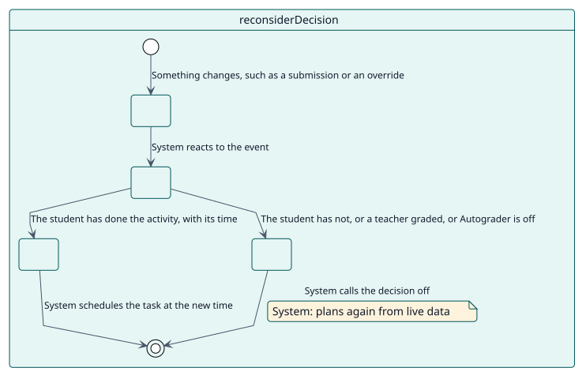
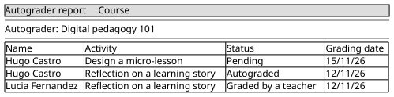

# UC-004 Reconsider a decision when something changes

| Overview | Requirements | Analysis | Design | Implementation | Tests |
| --- | --- | --- | --- | --- | --- |
| [Use cases](../../use-case-overview.svg) | **Requirements** | [Analysis](../../../analysis/use-cases/reconsiderDecision/README.md) | [Design](../../../design/use-cases/reconsiderDecision/README.md) | [Implementation](../../../implementation/use-cases/reconsiderDecision/README.md) | [Tests](../../../implementation/use-cases/reconsiderDecision/README.md#tests) |

## Use-case information

| Field | Value |
| --- | --- |
| Actor | System |
| Package | Grading |
| Goal | Keep each decision in line with what happens in the course. |
| Type | Primary, essential |
| Level | User goal |
| Requirement | RF-004 |
| Domain entities | Decision, Configuration, Student |

## Context

Students hand things in, undo them, get overrides, leave or change role. Autograder listens to those events and plans the decision again so it never waits on stale data.

## Preconditions

- Autograder is on in the activity.

## Postconditions

- Success: the decision is created, moved or called off to match the new situation.
- Failure: nothing changes; the grading task reads every condition again anyway.

## Main flow

| Step | Actor | System |
| --- | --- | --- |
| 1 |  | Receives an event: a completion, a submission, a manual mark of a quiz, an override, an enrolment, a role or a group change. |
| 2 |  | Checks that Autograder is on in the activity. |
| 3 |  | Plans the student again from live data. |
| 4 |  | Creates the decision, moves its time or calls it off, and schedules the task. |

## Alternative flows

| ID | Starts at step | Condition | Behaviour | Ends |
| --- | --- | --- | --- | --- |
| A1 | 2 | Autograder is off in the activity. | Does nothing. | End |
| A2 | 3 | The student has not done the activity. | Calls the decision off. | End |
| A3 | 3 | A teacher graded the student. | Marks the decision as manual. | End |
| A4 | 1 | A quiz that marks itself now has its own grade. | Gives the gradebook back to the quiz. | End |

## Business rules

| ID | Rule |
| --- | --- |
| RN-001 | A student is graded only after doing the activity. |
| RN-006 | There is one decision per student and activity. |
| RN-008 | A quiz that grades itself keeps its own grade. |

## Specification

Behaviour source of truth: [specification.puml](./specification.puml)

## Wireframes

