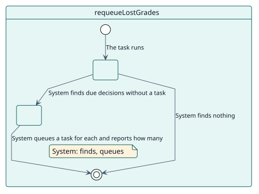
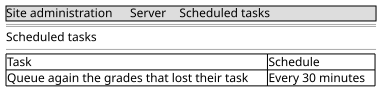

# UC-009 Queue again the grades that lost their task

| Overview | Requirements | Analysis | Design | Implementation | Tests |
| --- | --- | --- | --- | --- | --- |
| [Use cases](../../use-case-overview.svg) | **Requirements** | [Analysis](../../../analysis/use-cases/requeueLostGrades/README.md) | [Design](../../../design/use-cases/requeueLostGrades/README.md) | [Implementation](../../../implementation/use-cases/requeueLostGrades/README.md) | [Tests](../../../implementation/use-cases/requeueLostGrades/README.md#tests) |

## Use-case information

| Field | Value |
| --- | --- |
| Actor | System |
| Package | Grading |
| Goal | Make sure that no decision that is already due stays without a task that will grade it. |
| Type | Primary, essential |
| Level | User goal |
| Requirement | RF-009 |
| Domain entities | Decision |

## Context

Each decision has a task for its own moment. A queue emptied by hand, a site moved between servers or a fault can leave a due decision without one. This safety net runs every thirty minutes and, on a healthy site, finds nothing.

## Preconditions

- There are pending decisions.

## Postconditions

- Success: every due decision without a task has one again.
- Failure: a batch that is full is continued by the next run.

## Main flow

| Step | Actor | System |
| --- | --- | --- |
| 1 |  | Runs every thirty minutes and looks for pending decisions that are already due and have no task. |
| 2 |  | Queues a grading task for each one. |
| 3 |  | Says how many it queued again and, when the batch was full, that the next run will continue. |

## Alternative flows

| ID | Starts at step | Condition | Behaviour | Ends |
| --- | --- | --- | --- | --- |
| A1 | 1 | There are none. | Does nothing. | End |

## Business rules

| ID | Rule |
| --- | --- |
| RN-013 | A pending decision that is due and has no task behind it is queued again; a healthy site finds none. |
| RN-005 | Everything that matters is checked again when the grade is due. |

## Specification

Behaviour source of truth: [specification.puml](./specification.puml)

## Wireframes

