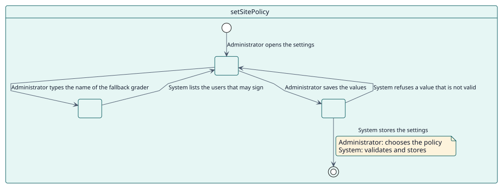
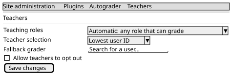

# UC-007 Set the policy of the site

| Overview | Requirements | Analysis | Design | Implementation | Tests |
| --- | --- | --- | --- | --- | --- |
| [Use cases](../../use-case-overview.svg) | **Requirements** | [Analysis](../../../analysis/use-cases/setSitePolicy/README.md) | [Design](../../../design/use-cases/setSitePolicy/README.md) | [Implementation](../../../implementation/use-cases/setSitePolicy/README.md) | [Tests](../../../implementation/use-cases/setSitePolicy/README.md#tests) |

## Use-case information

| Field | Value |
| --- | --- |
| Actor | Administrator |
| Package | Configuration |
| Goal | Decide who signs the grades, which notices are sent and how long the history is kept. |
| Type | Primary, essential |
| Level | User goal |
| Requirement | RF-008 |
| Domain entities | SitePolicy, Grader, OptOut |

## Context

The settings of the plugin are in two tabs of the administration: the general ones (notices and history) and the ones of the teachers (which roles, how to choose among them, the fallback grader and whether opting out is offered).

## Preconditions

- The administrator holds `moodle/site:config`.

## Postconditions

- Success: the settings are saved and apply from the next grade.
- Failure: a value that is not valid is refused and the previous one stays.

## Main flow

| Step | Actor | System |
| --- | --- | --- |
| 1 | Opens the settings of Autograder in the administration. | Shows the general tab and the tab of the teachers. |
| 2 | Chooses whether students are notified, whether teachers are told of the failures and how many days the history is kept. | Validates the values; when the failure notices are switched on, starts their count from that moment. |
| 3 | Chooses the roles that count as teachers, how to choose among several teachers and whether opting out is offered. | Saves them; the next grade is chosen with them. |
| 4 | Searches for a fallback grader by name and chooses one. | Lists only the users that may sign and saves the chosen one. |

## Alternative flows

| ID | Starts at step | Condition | Behaviour | Ends |
| --- | --- | --- | --- | --- |
| A1 | 2 | The retention is not a whole number of days. | Refuses the value. | Step 2 |
| A2 | 4 | The chosen user cannot be the fallback grader. | Refuses it with a message: administrators and users without a grading role are never used. | Step 4 |

## Business rules

| ID | Rule |
| --- | --- |
| RN-016 | Site administrators and users without a role that can grade are never chosen to sign a grade, nor as the fallback grader. |
| RN-004 | The grade is recorded in the name of a teacher of the student; without one, the fallback grader signs. |

## Specification

Behaviour source of truth: [specification.puml](./specification.puml)

## Wireframes

