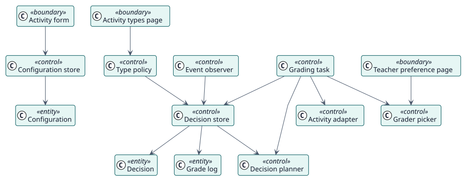

# Análisis

## Clases de análisis

Estereotipos: `<<boundary>>` interfaz, `<<control>>` coordinación, `<<entity>>` información del dominio.

| Clase | Estereotipo | Responsabilidad |
| --- | --- | --- |
| Formulario de la actividad, Página de tipos de actividad, Página de preferencias del docente | frontera | Las pantallas con las que trabajan docentes y administradores. |
| Almacén de configuración, Política de tipos | control | Guardan la configuración de una actividad y los tipos habilitados. |
| Planificador de decisiones | control | Decide, con datos actuales, si un estudiante hizo la actividad y cuándo vence la calificación. |
| Almacén de decisiones | control | Crea, mueve, cierra y cancela decisiones y sus tareas. |
| Observador de eventos | control | Hace que Autograder reconsidere a un estudiante cuando el curso cambia. |
| Tarea de calificación | control | Comprueba de nuevo y da la calificación en el momento en que vence. |
| Selector de calificador | control | Elige al docente a cuyo nombre se registra una calificación. |
| Adaptador de la actividad | control | Lee entregas y fechas, y escribe la calificación mediante cada clase de actividad. |
| Configuración, Decisión, Registro de calificación | entidad | La información almacenada. |

## Realizaciones de casos de uso

| ID | Caso de uso | Colaboración |
| --- | --- | --- |
| UC-001 | [Configurar Autograder en una actividad](./use-cases/configureAutograder/README.md) | [colaboración](./use-cases/configureAutograder/collaboration.svg) |
| UC-002 | [Elegir los tipos de actividad](./use-cases/chooseActivityTypes/README.md) | [colaboración](./use-cases/chooseActivityTypes/collaboration.svg) |
| UC-003 | [Calificar a un estudiante](./use-cases/gradeStudent/README.md) | [colaboración](./use-cases/gradeStudent/collaboration.svg) |
| UC-004 | [Reconsiderar una decisión cuando algo cambia](./use-cases/reconsiderDecision/README.md) | [colaboración](./use-cases/reconsiderDecision/collaboration.svg) |
