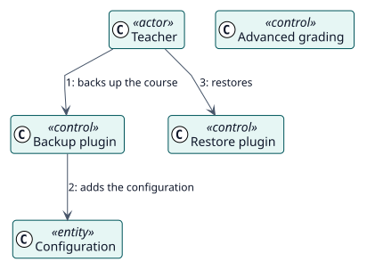

# UC-011 Llevar la configuración en una copia de seguridad del curso — realización del análisis

| Resumen | Requisitos | Análisis | Diseño | Implementación | Pruebas |
| --- | --- | --- | --- | --- | --- |
| [Casos de uso](../../../requirements/use-case-overview.svg) | [Requisitos](../../../requirements/use-cases/carryConfigurationInBackup/README.md) | **Análisis** | [Diseño](../../../design/use-cases/carryConfigurationInBackup/README.md) | [Implementación](../../../implementation/use-cases/carryConfigurationInBackup/README.md) | [Pruebas](../../../implementation/use-cases/carryConfigurationInBackup/README.md#pruebas) |

Requisitos: [README](../../../requirements/use-cases/carryConfigurationInBackup/README.md)

## Clases participantes

| Clase | Estereotipo | Responsabilidad |
| --- | --- | --- |
| Plugin de copia | control | Añade la configuración de una actividad a la copia. |
| Plugin de restauración | control | Escribe la configuración sobre la actividad restaurada y planifica a los estudiantes. |
| Calificación avanzada | control | Traslada la elección de una rúbrica o pauta a los criterios restaurados. |
| Configuración | entidad | Lo que viaja. |

## Colaboración

## Notas

Una actividad que volviera activada sin nada con lo que calificar fallaría una vez por cada estudiante, en el momento en que cada uno venciera, sin nada en pantalla que lo explique.
