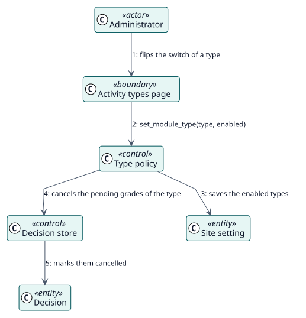

# UC-002 Elegir los tipos de actividad — realización del análisis

| Resumen | Requisitos | Análisis | Diseño | Implementación | Pruebas |
| --- | --- | --- | --- | --- | --- |
| [Casos de uso](../../../requirements/use-case-overview.svg) | [Requisitos](../../../requirements/use-cases/chooseActivityTypes/README.md) | **Análisis** | [Diseño](../../../design/use-cases/chooseActivityTypes/README.md) | [Implementación](../../../implementation/use-cases/chooseActivityTypes/README.md) | [Pruebas](../../../implementation/use-cases/chooseActivityTypes/README.md#pruebas) |

Requisitos: [README](../../../requirements/use-cases/chooseActivityTypes/README.md)

## Clases participantes

| Clase | Estereotipo | Responsabilidad |
| --- | --- | --- |
| Página de tipos de actividad | frontera | Una fila y un interruptor por cada tipo. |
| Política de tipos | control | Guarda los tipos habilitados. |
| Almacén de decisiones | control | Cancela las decisiones pendientes del tipo. |
| Ajuste del sitio | entidad | La lista de tipos habilitados. |
| Decisión | entidad | El registro que se cancela. |

## Colaboración

## Notas

Cada actividad conserva su propia configuración, de modo que al activar de nuevo el tipo se reanuda, salvo donde ya se registró una calificación.
