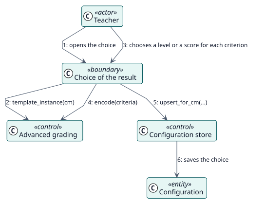

# UC-005 Elegir el resultado de una rúbrica o pauta de calificación — realización del análisis

| Resumen | Requisitos | Análisis | Diseño | Implementación | Pruebas |
| --- | --- | --- | --- | --- | --- |
| [Casos de uso](../../../requirements/use-case-overview.svg) | [Requisitos](../../../requirements/use-cases/chooseAdvancedGrade/README.md) | **Análisis** | [Diseño](../../../design/use-cases/chooseAdvancedGrade/README.md) | [Implementación](../../../implementation/use-cases/chooseAdvancedGrade/README.md) | [Pruebas](../../../implementation/use-cases/chooseAdvancedGrade/README.md#pruebas) |

Requisitos: [README](../../../requirements/use-cases/chooseAdvancedGrade/README.md)

## Clases participantes

| Clase | Estereotipo | Responsabilidad |
| --- | --- | --- |
| Elección del resultado | frontera | Muestra los criterios y recoge una respuesta para cada uno. |
| Calificación avanzada | control | Lee la definición, codifica y decodifica la elección e indica si está vigente. |
| Almacén de configuración | control | Guarda la elección con la configuración. |
| Configuración | entidad | Contiene la elección del resultado. |

## Colaboración

## Notas

Un docente que edita después la rúbrica deja obsoleta la elección anterior; el formulario de la actividad lo indica y pide la elección de nuevo.
