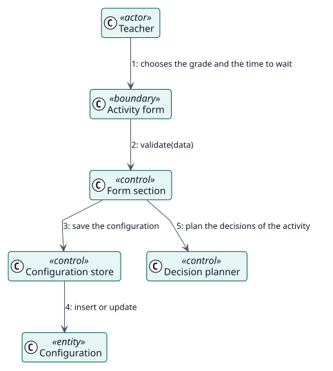

# UC-001 Configurar Autograder en una actividad — realización del análisis

| Resumen | Requisitos | Análisis | Diseño | Implementación | Pruebas |
| --- | --- | --- | --- | --- | --- |
| [Casos de uso](../../../requirements/use-case-overview.svg) | [Requisitos](../../../requirements/use-cases/configureAutograder/README.md) | **Análisis** | [Diseño](../../../design/use-cases/configureAutograder/README.md) | [Implementación](../../../implementation/use-cases/configureAutograder/README.md) | [Pruebas](../../../implementation/use-cases/configureAutograder/README.md#pruebas) |

Requisitos: [README](../../../requirements/use-cases/configureAutograder/README.md)

## Clases participantes

| Clase | Estereotipo | Responsabilidad |
| --- | --- | --- |
| Formulario de la actividad | frontera | Recoge la calificación y el tiempo de espera. |
| Sección del formulario | control | Valida y guarda la sección. |
| Almacén de configuración | control | Inserta o actualiza la configuración. |
| Planificador de decisiones | control | Planifica las decisiones de la actividad. |
| Configuración | entidad | Los ajustes de la actividad. |

## Colaboración

## Notas

La sección se añade a todos los formularios de actividad mediante los ganchos de formulario de Moodle y se guarda después de la propia actividad.
