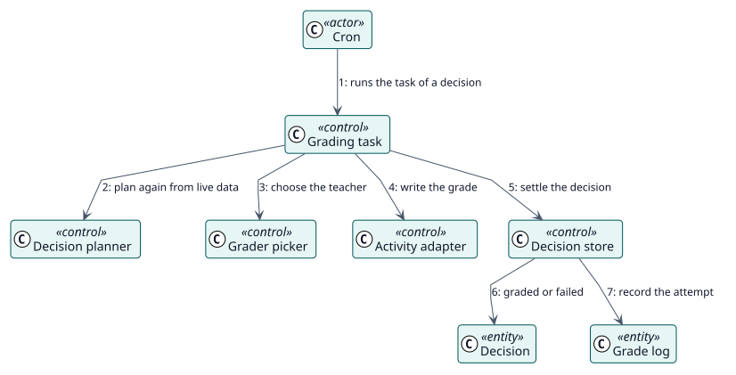

# UC-003 Calificar a un estudiante — realización del análisis

| Resumen | Requisitos | Análisis | Diseño | Implementación | Pruebas |
| --- | --- | --- | --- | --- | --- |
| [Casos de uso](../../../requirements/use-case-overview.svg) | [Requisitos](../../../requirements/use-cases/gradeStudent/README.md) | **Análisis** | [Diseño](../../../design/use-cases/gradeStudent/README.md) | [Implementación](../../../implementation/use-cases/gradeStudent/README.md) | [Pruebas](../../../implementation/use-cases/gradeStudent/README.md#pruebas) |

Requisitos: [README](../../../requirements/use-cases/gradeStudent/README.md)

## Clases participantes

| Clase | Estereotipo | Responsabilidad |
| --- | --- | --- |
| Tarea de calificación | control | Comprueba de nuevo y da la calificación. |
| Planificador de decisiones | control | Planifica de nuevo con datos actuales. |
| Selector de calificador | control | Elige al docente. |
| Adaptador de la actividad | control | Escribe la calificación mediante la actividad. |
| Almacén de decisiones | control | Cierra la decisión. |
| Decisión | entidad | El registro que se cierra. |
| Registro de calificación | entidad | La traza de auditoría del intento. |

## Colaboración

## Notas

Una tarea que encuentra su decisión ya cerrada no hace nada. Un evento perdido cuesta rapidez, nunca corrección.
