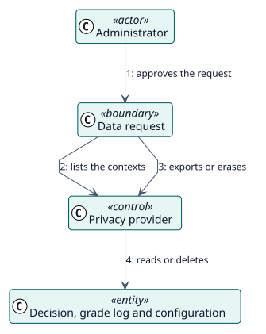

# UC-012 Exportar o eliminar datos personales — realización del análisis

| Resumen | Requisitos | Análisis | Diseño | Implementación | Pruebas |
| --- | --- | --- | --- | --- | --- |
| [Casos de uso](../../../requirements/use-case-overview.svg) | [Requisitos](../../../requirements/use-cases/managePersonalData/README.md) | **Análisis** | [Diseño](../../../design/use-cases/managePersonalData/README.md) | [Implementación](../../../implementation/use-cases/managePersonalData/README.md) | [Pruebas](../../../implementation/use-cases/managePersonalData/README.md#pruebas) |

Requisitos: [README](../../../requirements/use-cases/managePersonalData/README.md)

## Clases participantes

| Clase | Estereotipo | Responsabilidad |
| --- | --- | --- |
| Solicitud de datos | frontera | Donde el administrador aprueba la solicitud. |
| Proveedor de privacidad | control | Enumera, exporta y elimina lo que almacena el plugin. |
| Decisión, Registro de calificación, Configuración | entidad | Los datos almacenados. |

## Colaboración

## Notas

Los avisos de fallos pasan por la mensajería de Moodle, que tiene su propio proveedor de privacidad.
