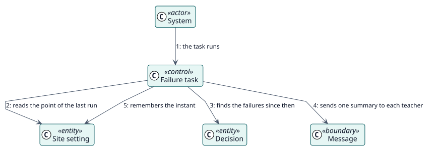

# UC-008 Avisar a los docentes de los estudiantes que no se pudieron calificar — realización del análisis

| Resumen | Requisitos | Análisis | Diseño | Implementación | Pruebas |
| --- | --- | --- | --- | --- | --- |
| [Casos de uso](../../../requirements/use-case-overview.svg) | [Requisitos](../../../requirements/use-cases/notifyFailures/README.md) | **Análisis** | [Diseño](../../../design/use-cases/notifyFailures/README.md) | [Implementación](../../../implementation/use-cases/notifyFailures/README.md) | [Pruebas](../../../implementation/use-cases/notifyFailures/README.md#pruebas) |

Requisitos: [README](../../../requirements/use-cases/notifyFailures/README.md)

## Clases participantes

| Clase | Estereotipo | Responsabilidad |
| --- | --- | --- |
| Tarea de fallos | control | Encuentra los fallos, los agrupa y envía los resúmenes. |
| Decisión | entidad | El registro que falló, con su motivo. |
| Ajuste del sitio | entidad | Si los avisos están activados y el instante de la última ejecución. |
| Mensaje | frontera | Lo que lee el docente. |

## Colaboración

## Notas

El resumen va a las personas que pueden actuar, no al docente a cuyo nombre se habría registrado una calificación: una decisión fallida no guarda calificador.
