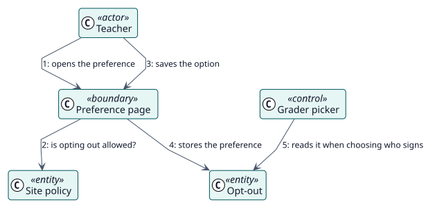

# UC-006 Excluirme de que se registren calificaciones a mi nombre — realización del análisis

| Resumen | Requisitos | Análisis | Diseño | Implementación | Pruebas |
| --- | --- | --- | --- | --- | --- |
| [Casos de uso](../../../requirements/use-case-overview.svg) | [Requisitos](../../../requirements/use-cases/optOutOfGrading/README.md) | **Análisis** | [Diseño](../../../design/use-cases/optOutOfGrading/README.md) | [Implementación](../../../implementation/use-cases/optOutOfGrading/README.md) | [Pruebas](../../../implementation/use-cases/optOutOfGrading/README.md#pruebas) |

Requisitos: [README](../../../requirements/use-cases/optOutOfGrading/README.md)

## Clases participantes

| Clase | Estereotipo | Responsabilidad |
| --- | --- | --- |
| Página de preferencia | frontera | Muestra la opción y la guarda. |
| Selector de docente | control | Deja fuera a los usuarios que se excluyeron cuando elige quién firma. |
| Política del sitio | entidad | Indica si se ofrece la exclusión. |
| Exclusión | entidad | La preferencia del usuario. |

## Colaboración

## Notas

Con pocos docentes, las exclusiones pueden dejar a un estudiante sin nadie que firme la calificación; entonces firma el calificador de reserva del sitio y, sin él, la calificación falla.
