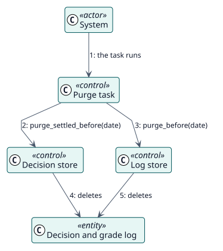

# UC-010 Eliminar el historial antiguo — realización del análisis

| Resumen | Requisitos | Análisis | Diseño | Implementación | Pruebas |
| --- | --- | --- | --- | --- | --- |
| [Casos de uso](../../../requirements/use-case-overview.svg) | [Requisitos](../../../requirements/use-cases/purgeHistory/README.md) | **Análisis** | [Diseño](../../../design/use-cases/purgeHistory/README.md) | [Implementación](../../../implementation/use-cases/purgeHistory/README.md) | [Pruebas](../../../implementation/use-cases/purgeHistory/README.md#pruebas) |

Requisitos: [README](../../../requirements/use-cases/purgeHistory/README.md)

## Clases participantes

| Clase | Estereotipo | Responsabilidad |
| --- | --- | --- |
| Tarea de depuración | control | Calcula la fecha y pide a ambos almacenes que eliminen. |
| Almacén de decisiones | control | Elimina las decisiones terminadas anteriores a la fecha. |
| Almacén del registro | control | Elimina las entradas del registro anteriores a la fecha. |
| Decisión, Registro de calificación | entidad | Lo que se elimina. |

## Colaboración

## Notas

Las decisiones fallidas también se eliminan: una retención menor que el intervalo de los avisos de fallos eliminaría fallos antes de informarlos.
